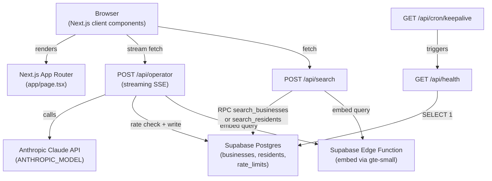
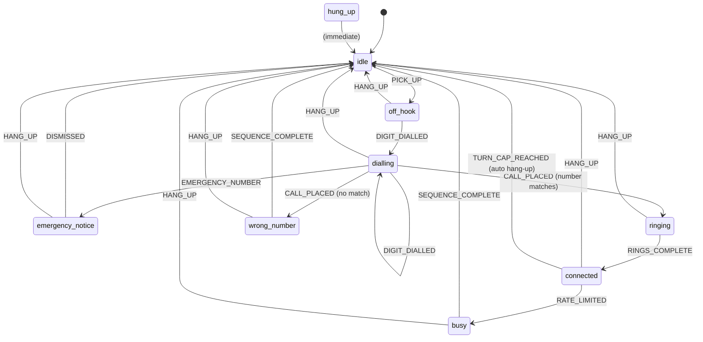

# Design Document: Dial Tone from the Grave

---

## Overview

Dial Tone from the Grave is a Next.js 15 App Router web app. The user interacts with a rotary phone in the browser. Dialling a known number connects them to a ghost operator persona backed by Claude. The 1023 operator uses hybrid vector search over a Postgres database to answer directory enquiries. All AI and database calls happen server-side. The browser never receives API keys.

---

## Architecture

The app is a Next.js 15 App Router project. All Claude calls and all Supabase service-role operations happen server-side only. The browser never sees API keys.



Data flow for a directory enquiries call:

1. User dials 1023, browser sends `POST /api/operator` with `{ number: "1023", message: "...", history: [...] }`.
2. Server checks rate limits in `rate_limits` table.
3. Server embeds the query via the Supabase Edge Function.
4. Claude receives the system prompt and tools. It calls `search_businesses` or `search_residents` as a tool call.
5. Server executes the matching SQL RPC, gets results, feeds them back to Claude as the tool result.
6. Claude streams its reply. Server forwards each SSE chunk to the browser.
7. Browser appends streamed text, starts `speechSynthesis`, and (on tool result receipt) opens the phone book page.

---

### API contracts

### POST /api/operator

Streams operator replies as Server-Sent Events.

Request body (validated by Zod):

```typescript
type OperatorRequest = {
  number: string; // e.g. "1023"
  message: string; // user input, max MAX_INPUT_CHARS chars
  history: Array<{
    role: 'user' | 'assistant';
    content: string;
  }>; // previous turns in this call, max MAX_TURNS_PER_CALL entries
  turnIndex: number; // 0-based, used to enforce turn cap server-side
};
```

SSE event types streamed back:

```typescript
// text delta
{ type: "delta";    text: string }

// tool call started (1023 only)
{ type: "tool_start"; tool: "search_businesses" | "search_residents"; query: string }

// tool result (send to browser so phone book page opens)
{ type: "tool_result"; results: BusinessResult[] | ResidentResult[] }

// stream complete
{ type: "done" }

// error
{ type: "error"; code: "rate_limited" | "turn_cap" | "input_too_long" | "operator_down" | "invalid_number" }
```

HTTP errors (before stream opens):

| Status | code           | Meaning                         |
| ------ | -------------- | ------------------------------- |
| 400    | invalid_body   | Zod validation failed           |
| 400    | input_too_long | message exceeds MAX_INPUT_CHARS |
| 400    | invalid_number | number not in operators map     |
| 429    | rate_limited   | IP or global cap hit            |
| 500    | operator_down  | Claude call failed              |

### POST /api/search

For direct search calls (used when 1313 is dialled, bypassing Claude).

Request body:

```typescript
type SearchRequest = {
  type: 'businesses' | 'residents';
  query: string; // max 300 chars
  spooky?: boolean; // include spirit listings
  spiritOnly?: boolean; // 1313 path: return only spirit listings
};
```

Response:

```typescript
type SearchResponse = {
  results: BusinessResult[] | ResidentResult[];
  type: 'businesses' | 'residents';
};

type BusinessResult = {
  id: string;
  name: string;
  category: string;
  suburb: string;
  address: string;
  phone: string;
  hours: string;
  is_24hr: boolean;
  description: string;
  is_advert: boolean;
  is_spirit: boolean;
  score: number;
};

type ResidentResult = {
  id: string;
  surname: string;
  initials: string;
  suburb: string;
  address: string;
  phone: string;
  score: number;
};
```

HTTP errors:

| Status | code          | Meaning               |
| ------ | ------------- | --------------------- |
| 400    | invalid_body  | Zod validation failed |
| 429    | rate_limited  | Search IP limit hit   |
| 500    | search_failed | Supabase RPC error    |

### GET /api/health

Returns `{ ok: true, ts: string }` after `SELECT 1` from Supabase. Returns 503 on failure. Used by the daily cron.

---

## Data Models

### businesses table

```sql
create table businesses (
  id          uuid primary key default gen_random_uuid(),
  name        text not null,
  category    text not null,
  suburb      text not null,
  address     text not null,
  phone       text not null,
  hours       text not null,
  is_24hr     boolean not null default false,
  description text not null,
  is_advert   boolean not null default false,
  is_spirit   boolean not null default false,
  embedding   vector(384),
  created_at  timestamptz not null default now()
);

create index businesses_embedding_idx
  on businesses
  using ivfflat (embedding vector_cosine_ops)
  with (lists = 50);

create index businesses_fts_idx
  on businesses
  using gin (to_tsvector('english', name || ' ' || category || ' ' || suburb || ' ' || description));

alter table businesses enable row level security;

-- Public read of non-spirit listings only. Spirit listings need the spooky flag via RPC.
create policy "public read non-spirit"
  on businesses for select
  using (true);
-- Write is secret key only (no insert/update/delete policy for anon or authenticated).
```

### residents table

```sql
create table residents (
  id         uuid primary key default gen_random_uuid(),
  surname    text not null,
  initials   text not null,
  suburb     text not null,
  address    text not null,
  phone      text not null,
  embedding  vector(384),
  created_at timestamptz not null default now()
);

create index residents_embedding_idx
  on residents
  using ivfflat (embedding vector_cosine_ops)
  with (lists = 20);

create index residents_surname_idx
  on residents (lower(surname) text_pattern_ops);

alter table residents enable row level security;

create policy "public read residents"
  on residents for select
  using (true);
```

### rate_limits table

```sql
create table rate_limits (
  id              text primary key,
  ip_hash         text,
  window_start    timestamptz,
  operator_count  int not null default 0,
  search_count    int not null default 0,
  date            date,
  claude_count    int not null default 0,
  updated_at      timestamptz not null default now()
);

alter table rate_limits enable row level security;
-- No public access. All reads and writes go through the secret key on the server.
```

The `id` column doubles as an IP-window key (format: `ip:{hash}:{window_epoch_hour}`) and a global daily key (`global:{date}`). This keeps the table simple with one row per IP per hour and one row per day.

### Embedding generation

Embeddings are generated by a Supabase Edge Function (`supabase/functions/embed/index.ts`) that calls the Supabase built-in `gte-small` model (384 dimensions). It is called:

- Once per business or resident row at seed time.
- Once per user query at search time (called from the server routes, not the browser).

The Edge Function accepts `{ text: string }` and returns `{ embedding: number[] }`.

---

## Components and Interfaces

```
app/page.tsx
  PhoneScene
    Handset              (pick up / hang up button, call state display)
    RotaryDial           (SVG dial, emits onDigit(d: string))
    DialledDisplay       (shows digits dialled so far)
    MuteToggle           (global audio mute, persists in sessionStorage)
    OperatorPanel        (shown when connected)
      TranscriptScroll   (streamed operator text)
      InputArea          (voice input OR typed fallback)
    PhoneBookOverlay     (shown when results arrive)
      PhoneBookPage
        PageHeader       (letter range, page number)
        BusinessSection  (business directory columns + boxed adverts)
          ListingCard    (individual listing, click for detail)
          AdvertCard     (boxed advert variant)
          ListingDetail  (torn-paper overlay on click)
        WhiteSection     (white pages columns)
          ResidentRow    (SURNAME Initial, address, phone)
        SectionTabs      (flip between white / business sections)
    StaticOverlay        (visual crackle/flicker on wrong-number and connect)
```

Props interfaces for key components:

```typescript
// RotaryDial is purely presentational
type RotaryDialProps = {
  disabled: boolean;
  onDigit: (digit: string) => void;
};

// Handset owns nothing except the callback
type HandsetProps = {
  state: CallState;
  onPickUp: () => void;
  onHangUp: () => void;
};

// PhoneBookPage receives results from parent, renders the right section
type PhoneBookPageProps = {
  businesses: BusinessResult[];
  residents: ResidentResult[];
  activeSection: 'business' | 'white';
  onSectionChange: (s: 'business' | 'white') => void;
  spiritOnly: boolean;
};
```

---

## Call Flow State Machine

### Why useReducer, not XState

XState is excellent but adds ~25 KB to the bundle and requires learning its API. The state machine here has 8 states and a small set of events; a plain `useReducer` with TypeScript discriminated unions covers it completely, is zero-dependency, and is straightforward to property-test. If the app grows significantly in complexity after the hackathon, XState is the natural next step.

### State machine diagram



### State shape and reducer events

```typescript
type CallState =
  | { status: 'idle' }
  | { status: 'off-hook' }
  | { status: 'dialling'; digits: string }
  | { status: 'ringing'; operatorNumber: string; ringsRemaining: number }
  | { status: 'connected'; operatorNumber: string; turnIndex: number }
  | { status: 'wrong-number' }
  | { status: 'emergency-notice' }
  | { status: 'busy' }
  | { status: 'hung-up' };

type CallEvent =
  | { type: 'PICK_UP' }
  | { type: 'HANG_UP' }
  | { type: 'DIGIT_DIALLED'; digit: string }
  | { type: 'CALL_PLACED' }
  | { type: 'EMERGENCY_NUMBER' }
  | { type: 'NUMBER_MATCHED'; operatorNumber: string; ringCount: number }
  | { type: 'NO_MATCH' }
  | { type: 'RING_TICK' }
  | { type: 'TURN_SENT' }
  | { type: 'TURN_CAP_REACHED' }
  | { type: 'RATE_LIMITED' }
  | { type: 'SEQUENCE_COMPLETE' }
  | { type: 'DISMISSED' };
```

The 2-second dial timer fires `CALL_PLACED`. The server 429 response fires `RATE_LIMITED`. The final turn auto-hang fires `TURN_CAP_REACHED`. The user dismissing the emergency notice fires `DISMISSED`.

---

## Rotary Dial Design

The dial is an SVG component (`components/RotaryDial/RotaryDial.tsx`). It is purely presentational: it receives `disabled` and `onDigit`, and emits nothing else.

### Geometry

Matches a real desk phone dial. Angles are degrees clockwise from 12 o'clock.

- Fixed base plate with the numbers and letters (2 ABC, 3 DEF and so on) printed on the outer ring, so they stay visible while the wheel turns.
- Clear finger wheel with 10 holes, 30 degrees apart, showing the pale plate underneath.
- Metal finger stop at `STOP_ANGLE = 130` (about 4 o'clock, bottom right).
- The 1 hole is 60 degrees anticlockwise of the stop, then each digit is one hole step further: `travelDegrees(d) = 60 + (PULSES[d] - 1) * 30`. So 1 travels 60 degrees and 0 travels 330 degrees, with a blank gap between the 0 hole and the stop.
- `HOLE_ANGLES[d] = (STOP_ANGLE - travelDegrees(d)) mod 360`.
- Centre card with the number handwritten in pen.

### Drag interaction

On `pointerdown` on a hole, the component records the hole index. On `pointermove`, it tracks the current angle. The dial plate SVG group rotates by `currentAngle - startAngle` (clamped to clockwise only, max = `STOP_ANGLE - holeAngle(d)`). On `pointerup`:

- If the hole reached the stop (within a 3-degree tolerance): register the digit.
- Otherwise: spring back without registering.

### Return animation

After registration, the dial returns anticlockwise from `STOP_ANGLE` to `holeAngle(d)` at exactly 10 pulses per second. Total return duration = `pulseCount(d) * 100` ms, where `pulseCount("1") = 1`, `pulseCount("0") = 10`. A click sound fires at each 100 ms interval.

With `prefers-reduced-motion`: skip the CSS transform animation entirely; set the rotation back to 0 immediately; still schedule the click sounds at 100 ms intervals (sound is not affected by motion preference).

### Keyboard path

On `keydown` for keys 0-9:

1. Animate the correct hole clockwise to the stop over ~150 ms (CSS transition).
2. After 150 ms, start the return animation as normal.
3. This triggers the same `onDigit` callback and the same click sequence.

With `prefers-reduced-motion`: skip both animations, fire `onDigit` immediately, still play clicks.

### Angle-to-digit mapping (property-tested)

All values live in `lib/dial.ts` and are derived from `STOP_ANGLE`, `HOLE_SPACING` (30) and `FIRST_HOLE_TRAVEL` (60), so the layout cannot drift out of step with the pulse counts.

| Digit | Hole angle | Travel to stop | Pulses |
| ----- | ---------- | -------------- | ------ |
| 1     | 70         | 60             | 1      |
| 2     | 40         | 90             | 2      |
| 3     | 10         | 120            | 3      |
| 4     | 340        | 150            | 4      |
| 5     | 310        | 180            | 5      |
| 6     | 280        | 210            | 6      |
| 7     | 250        | 240            | 7      |
| 8     | 220        | 270            | 8      |
| 9     | 190        | 300            | 9      |
| 0     | 160        | 330            | 10     |

Drag tracking uses `accumulateRotation`: each pointer move adds the shortest turn between the previous and current pointer angle, clamped between 0 and the digit's travel. This lets the 0 hole go most of the way round without jumping.

Property tests (fast-check):

- P1: `returnDuration(d) === PULSES[d] * 100` for every digit.
- P2: `PULSES[d]` equals the face value, 10 for "0".
- P3: hole angles are unique integers in [0, 360); travel grows by exactly one hole step per pulse and stays under a full turn.
- P4: `shouldRegister(d, short)` is true when released 3 degrees or less short of the stop, false otherwise; `accumulateRotation` never leaves the range 0 to `travelDegrees(d)` for any pointer path.

## Audio Design

All audio uses the Web Audio API. `lib/audio.ts` exports a singleton `AudioEngine` class that creates one `AudioContext` on first user interaction.

### Dial tone (South African standard: 400 Hz)

```
OscillatorNode (400 Hz, sine) -> GainNode (0.3) -> destination
```

Started on `off-hook`, stopped on `dialling`.

### Ring tone (SA standard: 400 + 450 Hz, cadence 400 ms on / 200 ms off / 400 ms on / 2 s off)

Two oscillators mixed through a gain node. The cadence is driven by a scheduler that sets `gain.value` via `setValueAtTime`.

### Busy tone (400 Hz, 375 ms on / 375 ms off)

Single oscillator with a gain envelope matching the cadence.

### Disconnected tone (rapid pip sequence)

400 Hz oscillator, 150 ms on / 150 ms off, 3 pips, then silence.

### Dial click

```
BufferSourceNode (white noise, 5 ms buffer)
  -> BiquadFilterNode (bandpass, 800 Hz, Q 2)
  -> GainNode (0.5)
  -> destination
```

One click fired per pulse at the start of each 100 ms return interval.

### Static and crackle

```
BufferSourceNode (white noise, looping)
  -> BiquadFilterNode (bandpass, 2000 Hz, Q 0.5)
  -> GainNode (amplitude modulated by LFO at 7-12 Hz)
  -> destination
```

The LFO is an `OscillatorNode` connected to `GainNode.gain` with a small range (0.05 to 0.4) to create irregular crackle rather than a steady hiss.

### Mute and autoplay

The `AudioContext` is created in `suspended` state and resumed on the first `pointerdown` or `keydown` event. The mute state is a boolean stored in `sessionStorage` under the key `dtftg_muted`. The `MuteToggle` component reads and writes this. When muted, the AudioEngine sets the master gain to 0 (nodes still run, no audible output, resume is instant on unmute).

---

## Operator Design

### Operator definition type

```typescript
// lib/operators.ts
export type VoiceConfig = {
  pitch: number; // 0.5 to 2.0
  rate: number; // 0.5 to 2.0
  voiceHint: string; // partial match against SpeechSynthesisVoice.name
};

export type OperatorDefinition = {
  number: string;
  name: string;
  systemPrompt: string;
  voiceConfig: VoiceConfig;
  ringCount: 2 | 3;
  tools: ('search_businesses' | 'search_residents')[];
  greeting: string; // sent as the first assistant message, no Claude call needed
};
```

### Operator personas

**1023 Directory Enquiries**

Ring count: 3. Tools: `search_businesses`, `search_residents`.

System prompt structure:

```
You are the operator at the Dead Pages telephone exchange, circa 1958.
You are a ghost. You are helpful, polite, slightly eerie, and efficient.
You speak in short, clear sentences. Never more than 4 sentences per reply.
You have two tools: search_businesses and search_residents.
Call search_businesses when the caller asks for a service, shop, tradesperson or any kind of business.
Call search_residents when the caller asks for a person by name.
When results are returned, summarise what you found in character. Do not list every result verbatim.
You may only describe businesses or people that appear in the tool results. Never invent listings.
If asked for a real or famous person, say: "I'm afraid the line to the living is out of order."
If the caller asks a follow-up about the current results (hours, address, etc.), answer from the results already provided. Do not call a tool again unless it is a new search request.
On the final turn (turn {MAX_TURNS_PER_CALL}), say goodbye in character and end the call.
Never claim to be a real service. Never give medical, legal or financial advice.
Refuse unsafe requests in character, without breaking persona.
```

Voice: pitch 1.1, rate 0.85, voiceHint "female" (or "Google UK English Female").

**1026 Speaking Clock**

Ring count: 2. Tools: none.

System prompt: tells the real current time in Africa/Johannesburg timezone (injected server-side from `new Date().toLocaleTimeString("en-ZA", { timeZone: "Africa/Johannesburg" })`), then adds one short spooky remark. Never engages in conversation; each call gets one reply only. The turn cap still applies but the persona naturally ends after the first turn.

Voice: pitch 0.8, rate 0.9, voiceHint "male".

**666 Night Caretaker**

Ring count: 2. Tools: none.

System prompt: grumpy ghost who has worked the night shift at the exchange for 60 years. Tells one short, original, family-friendly spooky story per call (about the exchange building, old cables, noises in the walls). No search tools. Stays in character. Max 4 sentences.

Voice: pitch 0.6, rate 0.8, voiceHint "male".

**1313 Spirit operator**

No Claude call. A hardcoded one-line greeting stored in `lib/operators.ts`. Immediately after sending the greeting, the server fires a `tool_result` with all spirit listings (bypassing Claude), and the browser opens the spirit-filtered phone book page. Turn cap: 1 (the greeting counts as turn 1; the call auto-hangs after the page opens).

Voice: pitch 1.3, rate 0.7, voiceHint "female".

### Claude call structure

Model: read from `ANTHROPIC_MODEL` env var (default `claude-haiku-5-5`). Max tokens: 300. Temperature: 0.7. Stream: true.

The request to Claude is built in `app/api/operator/route.ts`:

```typescript
{
  model: process.env.ANTHROPIC_MODEL ?? "claude-haiku-5-5",
  max_tokens: 300,
  system: operator.systemPrompt,
  messages: [...history, { role: "user", content: message }],
  tools: operator.tools.map(t => TOOL_DEFINITIONS[t]),
  stream: true,
}
```

Tool definitions passed to Claude:

```typescript
{
  name: "search_businesses",
  description: "Search the Dead Pages business directory for shops, services or tradespeople.",
  input_schema: {
    type: "object",
    properties: {
      query: { type: "string", description: "What the caller is looking for, in their words." },
      suburb: { type: "string", description: "Suburb or area mentioned by the caller, if any." },
      spooky: { type: "boolean", description: "True if the query sounds supernatural or spooky." },
    },
    required: ["query"],
  },
}

{
  name: "search_residents",
  description: "Search the Dead Pages white pages for a resident by name.",
  input_schema: {
    type: "object",
    properties: {
      surname: { type: "string", description: "Surname to search for." },
      initial: { type: "string", description: "First name or initial, if given." },
      suburb: { type: "string", description: "Suburb or area, if given." },
    },
    required: ["surname"],
  },
}
```

When Claude emits a `tool_use` block, the server intercepts it, runs the SQL RPC, and feeds the results back as `tool_result` before continuing the stream.

---

## Search Design

### search_businesses SQL RPC

```sql
create or replace function search_businesses(
  query_embedding vector(384),
  query_text      text,
  suburb_hint     text default null,
  include_spirit  boolean default false,
  spirit_only     boolean default false,
  match_count     int default 10
)
returns table (
  id          uuid,
  name        text,
  category    text,
  suburb      text,
  address     text,
  phone       text,
  hours       text,
  is_24hr     boolean,
  description text,
  is_advert   boolean,
  is_spirit   boolean,
  score       float
)
language sql stable
as $$
  select
    b.id, b.name, b.category, b.suburb, b.address,
    b.phone, b.hours, b.is_24hr, b.description, b.is_advert, b.is_spirit,
    (
      0.50 * (1 - (b.embedding <=> query_embedding))
      + 0.35 * ts_rank(
          to_tsvector('english', b.name || ' ' || b.category || ' ' || b.suburb || ' ' || b.description),
          plainto_tsquery('english', query_text)
        )
      + 0.15 * case when lower(b.suburb) = lower(suburb_hint) then 1.0 else 0.0 end
    ) as score
  from businesses b
  where
    (spirit_only = false or b.is_spirit = true)
    and (spirit_only = true or include_spirit = true or b.is_spirit = false)
  order by score desc
  limit match_count;
$$;
```

Scoring weights: 50% vector similarity, 35% full-text rank, 15% suburb exact match. These are tunable constants; the 1313 path passes `spirit_only = true`.

### search_residents SQL RPC

```sql
create or replace function search_residents(
  query_embedding vector(384),
  surname_hint    text,
  initial_hint    text default null,
  suburb_hint     text default null,
  match_count     int default 10
)
returns table (
  id       uuid,
  surname  text,
  initials text,
  suburb   text,
  address  text,
  phone    text,
  score    float
)
language sql stable
as $$
  select
    r.id, r.surname, r.initials, r.suburb, r.address, r.phone,
    (
      0.40 * (1 - (r.embedding <=> query_embedding))
      + 0.40 * case
                 when lower(r.surname) = lower(surname_hint) then 1.0
                 when similarity(lower(r.surname), lower(surname_hint)) > 0.4 then 0.6
                 else 0.0
               end
      + 0.10 * case when initial_hint is not null
                     and lower(r.initials) like lower(initial_hint) || '%'
                     then 1.0 else 0.0
               end
      + 0.10 * case when suburb_hint is not null
                     and lower(r.suburb) = lower(suburb_hint)
                     then 1.0 else 0.0
               end
    ) as score
  from residents r
  order by score desc
  limit match_count;
$$;
```

Trigram similarity requires `pg_trgm` extension (enabled in migration). Fuzzy surname matching handles "van der Merwe" vs "vd Merwe" through the similarity function and the 0.4 threshold.

### Spooky flag

`lib/spooky.ts` exports:

```typescript
export const SPOOKY_KEYWORDS = [
  'ghost',
  'haunt',
  'haunted',
  'seance',
  'seance',
  'spirit',
  'dead',
  'grave',
  'coffin',
  'witch',
  'vampire',
  'zombie',
  'cursed',
  'midnight',
];

export function isSpookyQuery(query: string): boolean {
  const lower = query.toLowerCase();
  return SPOOKY_KEYWORDS.some((kw) => lower.includes(kw));
}
```

The server checks this before calling the RPC and passes `include_spirit: true` if the query is spooky.

### Embedding at query time

The search route calls the Supabase Edge Function to get a 384-dimension vector for the user's query string, then passes it to the RPC. The Edge Function is called with the Supabase secret key (`SUPABASE_SECRET_KEY`), which only exists on the server.

---

## Rate Limiting Design

### Algorithm

Each incoming request to `/api/operator` or `/api/search`:

1. Hash the client IP with SHA-256 (hex, first 16 chars). Never store the raw IP.
2. Compute `windowKey = "ip:" + ipHash + ":" + Math.floor(Date.now() / 3_600_000)`.
3. Upsert into `rate_limits` with `on conflict (id) do update set operator_count = rate_limits.operator_count + 1` (or `search_count`). Use a SQL function to do this atomically.
4. Read back the updated count. If `> limit`, return 429 before touching Claude or the RPC.
5. For Claude calls only, also upsert `global:{today}` row and check `claude_count` against `CLAUDE_DAILY_GLOBAL_CAP`.

### SQL helper function

```sql
create or replace function increment_rate_limit(
  p_id            text,
  p_field         text,   -- 'operator_count', 'search_count', or 'claude_count'
  p_window_start  timestamptz default null,
  p_date          date default null
)
returns int
language plpgsql
as $$
declare
  new_count int;
begin
  insert into rate_limits (id, ip_hash, window_start, operator_count, search_count, date, claude_count, updated_at)
  values (p_id, split_part(p_id, ':', 2), p_window_start, 0, 0, p_date, 0, now())
  on conflict (id) do update
    set
      operator_count = case when p_field = 'operator_count' then rate_limits.operator_count + 1 else rate_limits.operator_count end,
      search_count   = case when p_field = 'search_count'   then rate_limits.search_count + 1   else rate_limits.search_count   end,
      claude_count   = case when p_field = 'claude_count'   then rate_limits.claude_count + 1   else rate_limits.claude_count   end,
      updated_at     = now()
  returning
    case when p_field = 'operator_count' then operator_count
         when p_field = 'search_count'   then search_count
         else claude_count
    end into new_count;
  return new_count;
end;
$$;
```

### Environment variables

| Variable                       | Default          | Meaning                                   |
| ------------------------------ | ---------------- | ----------------------------------------- |
| OPERATOR_LIMIT_PER_IP_PER_HOUR | 20               | Max operator calls per IP per hour        |
| SEARCH_LIMIT_PER_IP_PER_HOUR   | 60               | Max search calls per IP per hour          |
| CLAUDE_DAILY_GLOBAL_CAP        | 500              | Max Claude calls globally per day         |
| MAX_TURNS_PER_CALL             | 6                | Max user turns before auto hang-up        |
| MAX_INPUT_CHARS                | 300              | Max characters per user message           |
| ANTHROPIC_MODEL                | claude-haiku-5-5 | Claude model name used for operator calls |

---

## Error Handling

| Failure                             | Detection                                                            | User experience                                                                                                                                                                                                                                                                                                 |
| ----------------------------------- | -------------------------------------------------------------------- | --------------------------------------------------------------------------------------------------------------------------------------------------------------------------------------------------------------------------------------------------------------------------------------------------------------- |
| Claude API down / timeout           | fetch throws or returns 5xx                                          | SSE `{ type: "error", code: "operator_down" }`. UI shows "The operator is unreachable. Please try again later." Hang-up button remains active.                                                                                                                                                                  |
| Rate limit hit (IP)                 | count > limit before Claude call                                     | HTTP 429, state transitions to `busy`, busy tone plays, in-character "all lines are busy" message.                                                                                                                                                                                                              |
| Rate limit hit (global cap)         | claude_count > cap                                                   | Same as IP limit.                                                                                                                                                                                                                                                                                               |
| Turn cap reached                    | turnIndex >= MAX_TURNS_PER_CALL                                      | Operator says goodbye in character (last Claude call with goodbye instruction). State auto-hangs.                                                                                                                                                                                                               |
| Input too long                      | message.length > MAX_INPUT_CHARS                                     | SSE `{ type: "error", code: "input_too_long" }`. Operator says "I couldn't quite catch that" in character. No Claude call made.                                                                                                                                                                                 |
| SpeechRecognition unavailable       | feature-detect on mount                                              | Typed input field shown immediately. No error shown.                                                                                                                                                                                                                                                            |
| SpeechRecognition permission denied | `onerror` event                                                      | Typed input field shown. Small in-character note: "Speak up, dear, the line is faint" with the text box.                                                                                                                                                                                                        |
| speechSynthesis unavailable         | feature-detect on mount                                              | Text still displayed, voice reading silently skipped.                                                                                                                                                                                                                                                           |
| Offline                             | `navigator.onLine` + `online`/`offline` events                       | Overlay: "The exchange has gone dark. Check your connection." Dial disabled. Clears when online again.                                                                                                                                                                                                          |
| No search results                   | results.length === 0 from RPC                                        | Operator says in character: no match found, suggests broader search. Phone book shows "No listings found in this exchange."                                                                                                                                                                                     |
| Supabase RPC error                  | RPC returns error                                                    | `/api/search` returns 500. Operator falls back to "the directory is unavailable."                                                                                                                                                                                                                               |
| Emergency number dialled            | digits match EMERGENCY_NUMBERS set exactly (checked after 2 s pause) | State transitions to `emergency-notice`. A plain, calm, out-of-character screen and voice message is shown: "This is a game and cannot call anyone. If you have an emergency, please use a real phone and dial 112 or 10111." No static, no spooky effects. User dismisses or hangs up, then returns to `idle`. |

---

## Security Design

### Content Security Policy

Set via `next.config.ts` headers for all routes:

```
default-src 'self';
script-src 'self';
style-src 'self' 'unsafe-inline' https://fonts.googleapis.com;
font-src 'self' https://fonts.gstatic.com;
connect-src 'self' https://*.supabase.co;
img-src 'self' data:;
media-src 'none';
object-src 'none';
frame-ancestors 'none';
```

`'unsafe-inline'` for styles is required for Tailwind. No `'unsafe-eval'`. No external script sources.

### Input validation (Zod)

Every API route parses the request body through a Zod schema before any other work. Invalid requests get a 400 with no stack trace. The schemas are defined in `lib/schemas.ts` and imported by the routes.

### RLS summary

| Table       | Public read    | Public write | Secret key |
| ----------- | -------------- | ------------ | ---------- |
| businesses  | Yes (all rows) | No           | Yes        |
| residents   | Yes (all rows) | No           | Yes        |
| rate_limits | No             | No           | Yes        |

Spirit listings are readable by the public (the RPC filters them out in the default case; the `include_spirit` flag is set only by server-side code, not passed from the browser directly).

### Secret handling

- `ANTHROPIC_API_KEY`, `SUPABASE_SECRET_KEY`: used only in server routes. Never referenced in any client component.
- `NEXT_PUBLIC_SUPABASE_URL`, `NEXT_PUBLIC_SUPABASE_PUBLISHABLE_KEY`: safe to expose; RLS enforces access.
- `.env.example` committed with every variable name and a comment.
- `.env`, `.env.local`, `.env*.local` in `.gitignore`.
- `.kiro/` explicitly NOT in `.gitignore`.

---

## Testing Strategy

### Unit and component tests (Vitest + React Testing Library)

| Test                                                                       | Requirement   |
| -------------------------------------------------------------------------- | ------------- |
| RotaryDial emits correct digit on full drag to stop                        | Req 1 AC 1    |
| RotaryDial does not emit on early release                                  | Req 1 AC 2    |
| RotaryDial keyboard input animates and emits                               | Req 1 AC 5    |
| RotaryDial announces digit in ARIA live region                             | Req 1 AC 7    |
| callReducer: all state transitions                                         | Req 2 AC 1-10 |
| callReducer: emergency numbers route to emergency-notice, not wrong-number | Req 2 AC 8    |
| callReducer: digit ignored in connected state                              | Req 2 AC 9    |
| callReducer: busy state on RATE_LIMITED event                              | Req 2 AC 10   |
| OperatorPanel: shows typed input when speech unavailable                   | Req 3 AC 10   |
| /api/operator: Zod rejects invalid body (400)                              | Req 10 AC 7   |
| /api/operator: returns 429 when rate limit exceeded                        | Req 10 AC 4   |
| /api/operator: Claude key absent from response body                        | Req 10 AC 5   |
| /api/search: spooky flag includes spirit listings                          | Req 7 AC 2    |
| /api/search: spirit_only flag returns only spirit listings                 | Req 7 AC 3    |
| isSpookyQuery: returns true for each keyword in list                       | Req 7 AC 2    |
| PhoneBookPage: business section shows boxed adverts                        | Req 5 AC 2    |
| PhoneBookPage: torn-paper card opens on listing click                      | Req 5 AC 6    |
| PhoneBookPage: white pages shows SURNAME Initial format                    | Req 6 AC 1    |
| AudioEngine: starts muted, unmutes on interaction                          | Req 8 AC 7    |

### Property-based tests (fast-check)

| Property                                                                                 | Requirement   |
| ---------------------------------------------------------------------------------------- | ------------- |
| For every digit d in "0"-"9": `PULSES[d] * 100 === returnDuration(d)`                    | Req 1 AC 3    |
| For every digit d: `PULSES[d]` equals numeric value of d (1-9), or 10 for "0"            | Req 1 AC 4    |
| For every digit d: `HOLE_ANGLES[d]` is a unique integer in [0, 360)                      | Req 1 AC 1    |
| For drag angle within 3 degrees of stop: `shouldRegister` is true                        | Req 1 AC 1    |
| For drag angle more than 3 degrees before stop: `shouldRegister` is false                | Req 1 AC 2    |
| For every sequence of events, `callReducer` never reaches an undefined state             | Req 2 AC 1    |
| For any input text, `isSpookyQuery` returns true iff at least one keyword is a substring | Req 7 AC 2    |
| For any count <= limit: `checkRateLimit` returns allowed                                 | Req 10 AC 1-3 |
| For any count > limit: `checkRateLimit` returns denied                                   | Req 10 AC 1-3 |
| For any string longer than MAX_INPUT_CHARS: input validation rejects it                  | Req 3 AC 9    |
| For any emergency number string: `isEmergencyNumber` returns true                        | Req 2 AC 8    |

### End-to-end tests (Playwright)

| Scenario                                                                                | Requirement |
| --------------------------------------------------------------------------------------- | ----------- |
| Full 1023 call: dial, connect, ask for plumber in Edenvale, phone book opens            | Req 2, 4, 5 |
| Full 1026 call: dial, connect, receive time, auto-hang                                  | Req 2, 3    |
| Wrong number: dial unknown number, static plays, returns to idle                        | Req 2 AC 6  |
| Emergency number: dial 112, emergency-notice screen shown with plain message, no static | Req 2 AC 8  |
| Rate limit: mock 429, busy state entered, in-character message shown                    | Req 10 AC 4 |
| 1313 easter egg: dial 1313, spirit listings open                                        | Req 7 AC 3  |
| Keyboard dial: press "5", hear 5 clicks, digit shown                                    | Req 1 AC 5  |
| Offline state: go offline, in-character message shown, dial disabled                    | Req 9 AC 8  |

---

## Deployment

### Vercel configuration

`vercel.json`:

```json
{
  "crons": [
    {
      "path": "/api/cron/keepalive",
      "schedule": "0 10 * * *"
    }
  ]
}
```

The cron fires daily at 10:00 UTC, which calls `/api/health`. This keeps the Supabase free project from pausing.

### Environment variables (full list for .env.example)

```bash
# Supabase
NEXT_PUBLIC_SUPABASE_URL=       # your Supabase project URL
NEXT_PUBLIC_SUPABASE_PUBLISHABLE_KEY=  # publishable key (sb_publishable_...); safe to expose
SUPABASE_SECRET_KEY=              # secret key (sb_secret_...); server-side only, never in client bundle

# Anthropic
ANTHROPIC_API_KEY=              # server-side only
ANTHROPIC_MODEL=claude-haiku-5-5  # Claude model; change to test different versions

# Rate limits (all optional, defaults shown)
OPERATOR_LIMIT_PER_IP_PER_HOUR=20
SEARCH_LIMIT_PER_IP_PER_HOUR=60
CLAUDE_DAILY_GLOBAL_CAP=500
MAX_TURNS_PER_CALL=6
MAX_INPUT_CHARS=300

# Vercel cron secret (set in Vercel dashboard, used to protect the cron endpoint)
CRON_SECRET=
```

### Build checks

The Vercel build runs `tsc --noEmit` and `eslint` as part of the Next.js build. Any type error or lint error fails the deployment. This is enforced by leaving the default Next.js build config in place (no `ignoreBuildErrors: true`).

### Supabase migrations

Migrations live in `supabase/migrations/` and are applied with `supabase db push` before deployment. The order is:

1. `0001_extensions.sql`: enable `pgvector`, `pg_trgm`.
2. `0002_businesses.sql`: create businesses table, indexes, RLS.
3. `0003_residents.sql`: create residents table, indexes, RLS.
4. `0004_rate_limits.sql`: create rate_limits table, RLS, helper function.
5. `0005_rpcs.sql`: create `search_businesses` and `search_residents` functions.
6. `0006_seed_businesses.sql`: insert ~150 fictional businesses + ~12 spirit listings.
7. `0007_seed_residents.sql`: insert ~80 fictional residents.

Seed files call the embed Edge Function for each row to generate and store embeddings.

---

## Correctness Properties

These are the formal properties the implementation must satisfy. Each maps to at least one test.

### Property 1: Dial return timing

For every digit d in "0"-"9", `returnDuration(d) === PULSES[d] * 100` ms. Test type: property-based (fast-check).

**Validates: Requirements 1.3**

### Property 2: Pulse count matches face value

For every digit d, `PULSES[d]` equals the numeric face value of d for digits 1-9, and equals 10 for "0". Test type: property-based.

**Validates: Requirements 1.4**

### Property 3: Hole angles are unique

For every pair of distinct digits d1 and d2, `HOLE_ANGLES[d1] !== HOLE_ANGLES[d2]`. All angles are integers in [0, 360). Test type: property-based.

**Validates: Requirements 1.1**

### Property 4: Drag registration threshold

A drag released within 3 degrees of the finger stop registers the digit. A drag released more than 3 degrees before the stop does not. Test type: property-based.

**Validates: Requirements 1.1, 1.2**

### Property 5: State machine completeness

For any sequence of valid events applied to any valid state, the call reducer returns a defined state. It never returns undefined or throws. Test type: property-based.

**Validates: Requirements 2.1**

### Property 6: Emergency number intercept

When the exact dialled string (after the 2-second pause) matches any entry in the EMERGENCY_NUMBERS set (10111, 10177, 107, 112, 911, 999), the reducer transitions to `emergency-notice`, not `wrong-number`. Prepending or appending extra digits produces a different string that is not in the set and must not trigger the intercept. The EMERGENCY_NUMBERS set is the single source of truth (defined in `lib/operators.ts`). Test type: property-based.

**Validates: Requirements 2.8**

### Property 7: Spooky query detection

`isSpookyQuery(q)` returns true if and only if q contains at least one word from SPOOKY_KEYWORDS as a substring (case-insensitive). Test type: property-based.

**Validates: Requirements 7.2**

### Property 8: Spirit listing exclusion

When `include_spirit = false` and `spirit_only = false`, no result in the returned set has `is_spirit = true`. Test type: unit.

**Validates: Requirements 7.2**

### Property 9: Spirit listing inclusion

When `include_spirit = true` or `spirit_only = true`, spirit listings appear in the result set when they exist and score within the top 10. Test type: unit.

**Validates: Requirements 7.2, 7.3**

### Property 10: Rate limit allows under cap

For any count c <= limit L, `checkRateLimit(c, L)` returns allowed. Test type: property-based.

**Validates: Requirements 10.1, 10.2, 10.3**

### Property 11: Rate limit denies over cap

For any count c > limit L, `checkRateLimit(c, L)` returns denied. Test type: property-based.

**Validates: Requirements 10.1, 10.2, 10.3**

### Property 12: Input length gate

For any string s where `s.length > MAX_INPUT_CHARS`, the Zod operator schema rejects it with a validation error. Test type: property-based.

**Validates: Requirements 3.9**

### Property 13: Operator fabrication prevention

The 1023 operator never names a business or resident that does not appear in the tool result returned by the search RPC. Test type: manual review and E2E.

**Validates: Requirements 4.7**
