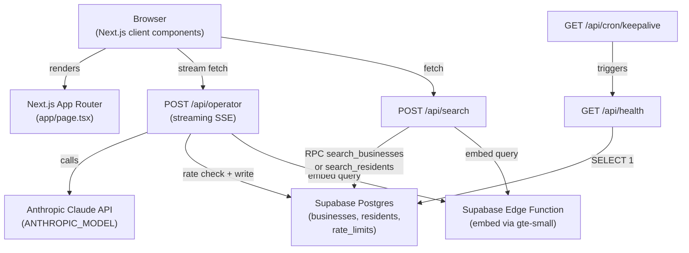
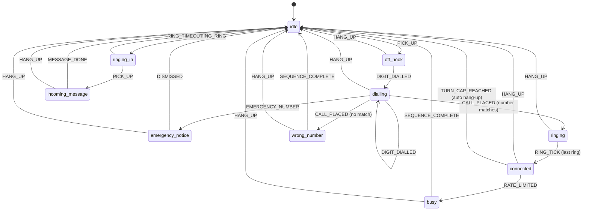

# Design Document: Dial Tone from the Grave

---

## Overview

Dial Tone from the Grave is a Next.js 15 App Router web app. The user interacts with a rotary phone in the browser. Dialling a known number connects them to a ghost operator persona backed by Claude. The 1023 operator uses hybrid vector search over a Postgres database to answer directory enquiries, and the results open in The Dead Pages, a cursed phone book. Every number in the book can be dialled, and the ghost of that business or household answers. The phone sometimes rings by itself, and the book remembers the session. It is set in Johannesburg: the suburbs, the trades, the voices and the time are local. All AI and database calls happen server-side. The browser never receives API keys.

---

## Architecture

The app is a Next.js 15 App Router project. All Claude calls and all Supabase service-role operations happen server-side only. The browser never sees API keys.



Data flow for a directory enquiries call:

1. User dials 1023, browser sends `POST /api/operator` with `{ number: "1023", message: "...", history: [...] }`.
2. Server checks rate limits in `rate_limits` table.
3. Server embeds the query via the Supabase Edge Function.
4. Claude receives the system prompt and tools. It calls `search_businesses` or `search_residents` as a tool call.
5. Server executes the matching SQL RPC, gets results, feeds them back to Claude as the tool result.
6. Claude streams its reply. Server forwards each SSE chunk to the browser.
7. Browser appends streamed text, starts `speechSynthesis`, and (on tool result receipt) opens the phone book page.

---

### API contracts

### POST /api/operator

Streams operator replies as Server-Sent Events.

Request body (validated by Zod):

```typescript
type OperatorRequest = {
  number: string; // e.g. "1023"
  message: string; // user input, max MAX_INPUT_CHARS chars
  history: Array<{
    role: 'user' | 'assistant';
    content: string;
  }>; // previous turns in this call, max MAX_TURNS_PER_CALL entries
  turnIndex: number; // 0-based, used to enforce turn cap server-side
};
```

SSE event types streamed back:

```typescript
// text delta
{ type: "delta";    text: string }

// tool call started (1023 only)
{ type: "tool_start"; tool: "search_businesses" | "search_residents"; query: string }

// tool result (send to browser so phone book page opens)
{ type: "tool_result"; results: BusinessResult[] | ResidentResult[] }

// stream complete
{ type: "done" }

// error
{ type: "error"; code: "rate_limited" | "turn_cap" | "input_too_long" | "operator_down" | "invalid_number" }
```

HTTP errors (before stream opens):

| Status | code           | Meaning                         |
| ------ | -------------- | ------------------------------- |
| 400    | invalid_body   | Zod validation failed           |
| 400    | input_too_long | message exceeds MAX_INPUT_CHARS |
| 400    | invalid_number | number not in operators map     |
| 429    | rate_limited   | IP or global cap hit            |
| 500    | operator_down  | Claude call failed              |

### POST /api/search

For direct search calls (used when 1313 is dialled, bypassing Claude).

Request body:

```typescript
type SearchRequest = {
  type: 'businesses' | 'residents';
  query: string; // max 300 chars
  spooky?: boolean; // include spirit listings
  spiritOnly?: boolean; // 1313 path: return only spirit listings
};
```

Response:

```typescript
type SearchResponse = {
  results: BusinessResult[] | ResidentResult[];
  type: 'businesses' | 'residents';
};

type BusinessResult = {
  id: string;
  name: string;
  category: string;
  suburb: string;
  address: string;
  phone: string;
  hours: string;
  is_24hr: boolean;
  description: string;
  is_advert: boolean;
  is_spirit: boolean;
  score: number;
};

type ResidentResult = {
  id: string;
  surname: string;
  initials: string;
  suburb: string;
  address: string;
  phone: string;
  score: number;
};
```

HTTP errors:

| Status | code          | Meaning               |
| ------ | ------------- | --------------------- |
| 400    | invalid_body  | Zod validation failed |
| 429    | rate_limited  | Search IP limit hit   |
| 500    | search_failed | Supabase RPC error    |

### POST /api/number

Tells the browser what a dialled number reaches, so it can ring or play a wrong number. Called by `useCall` after the 2-second pause, for numbers that are not operators or emergency numbers.

Request body (Zod): `{ digits: string }`, 3 to 12 digits, nothing else.

Response:

```typescript
type NumberResponse = { kind: 'listing'; ringCount: 2 } | { kind: 'none' };
```

It returns no listing details: the persona is built on the server when the call connects. It counts against the search limit per IP (Requirement 10, AC 2). Errors: 400 `invalid_body`, 429 `rate_limited`, 500 `lookup_failed`.

`POST /api/operator` accepts a listing number as `number` too. The server looks the listing up with `lookup_number`, builds the listing ghost's system prompt from that row (see Session Features), and applies `MAX_TURNS_PER_LISTING_CALL`. An unknown number is still a 400 `invalid_number`.

### GET /api/health

Returns `{ ok: true, ts: string }` after `SELECT 1` from Supabase. Returns 503 on failure. Used by the daily cron.

---

## Data Models

### businesses table

```sql
create table businesses (
  id          uuid primary key default gen_random_uuid(),
  name        text not null,
  category    text not null,
  suburb      text not null,
  address     text not null,
  phone       text not null,
  hours       text not null,
  is_24hr     boolean not null default false,
  description text not null,
  is_advert   boolean not null default false,
  is_spirit   boolean not null default false,
  embedding   vector(384),
  created_at  timestamptz not null default now()
);

create index businesses_embedding_idx
  on businesses
  using ivfflat (embedding vector_cosine_ops)
  with (lists = 50);

create index businesses_fts_idx
  on businesses
  using gin (to_tsvector('english', name || ' ' || category || ' ' || suburb || ' ' || description));

alter table businesses enable row level security;

-- Public read of non-spirit listings only. Spirit listings need the spooky flag via RPC.
create policy "public read non-spirit"
  on businesses for select
  using (true);
-- Write is secret key only (no insert/update/delete policy for anon or authenticated).

-- Every listing can be dialled. Digits only, unique, so a dialled number finds one listing.
-- A check constraint keeps every number in the fictional 011 000 xxxx range.
alter table businesses add column phone_digits text
  generated always as (regexp_replace(phone, '\D', '', 'g')) stored;
create unique index businesses_phone_digits_idx on businesses (phone_digits);
```

### residents table

```sql
create table residents (
  id         uuid primary key default gen_random_uuid(),
  surname    text not null,
  initials   text not null,
  suburb     text not null,
  address    text not null,
  phone      text not null,
  embedding  vector(384),
  created_at timestamptz not null default now()
);

create index residents_embedding_idx
  on residents
  using ivfflat (embedding vector_cosine_ops)
  with (lists = 20);

create index residents_surname_idx
  on residents (lower(surname) text_pattern_ops);

alter table residents enable row level security;

create policy "public read residents"
  on residents for select
  using (true);

alter table residents add column phone_digits text
  generated always as (regexp_replace(phone, '\D', '', 'g')) stored;
create unique index residents_phone_digits_idx on residents (phone_digits);
```

### lookup_number RPC

```sql
create function lookup_number(digits text)
returns table (kind text, id uuid, name text, category text, suburb text, address text,
               hours text, description text, is_spirit boolean)
language sql stable security invoker as $$
  select 'business', id, name, category, suburb, address, hours, description, is_spirit
    from businesses where phone_digits = digits
  union all
  select 'resident', id, surname || ' ' || initials, null, suburb, address, null, null, false
    from residents where phone_digits = digits
  limit 1;
$$;
```

The two unique indexes stop a number being used twice in one table. A seed test stops a number being used in both tables, and stops any listing number matching an operator or emergency number.

### rate_limits table

```sql
create table rate_limits (
  id              text primary key,
  ip_hash         text,
  window_start    timestamptz,
  operator_count  int not null default 0,
  search_count    int not null default 0,
  date            date,
  claude_count    int not null default 0,
  updated_at      timestamptz not null default now()
);

alter table rate_limits enable row level security;
-- No public access. All reads and writes go through the secret key on the server.
```

The `id` column doubles as an IP-window key (format: `ip:{hash}:{window_epoch_hour}`) and a global daily key (`global:{date}`). This keeps the table simple with one row per IP per hour and one row per day.

### Embedding generation

Embeddings are generated by a Supabase Edge Function (`supabase/functions/embed/index.ts`) that calls the Supabase built-in `gte-small` model (384 dimensions). It is called:

- Once per business or resident row at seed time.
- Once per user query at search time (called from the server routes, not the browser).

The Edge Function accepts `{ text: string }` and returns `{ embedding: number[] }`.

As built:

- **Model:** `Supabase.ai.Session('gte-small')`, with `mean_pool` and `normalize`, so every embedding has length 1 and cosine distance works directly.
- **Callers:** only the server. The function uses `withSupabase({ auth: 'secret' })` from `@supabase/server`, which accepts only the project's `default` secret key on the `apikey` header. `verify_jwt` is off for `embed`, because secret keys are not JWTs. No key and the publishable key both get a 401, so the browser can never call it and nobody else can spend its compute.
- **Code:** `handler.ts` holds the logic and imports nothing from Deno or npm, so Vitest and `tsc` check it. `index.ts` only wires it up.
- **Deploy and check:** `pnpm fn:deploy embed` deploys it (bundled by Supabase, no Docker), with `SUPABASE_ACCESS_TOKEN` passed through the environment. `pnpm fn:smoke` checks the live function, printing only status codes and sizes. A geyser query scores 0.891 against a plumber and 0.726 against a pharmacy.

---

## Components and Interfaces

The page has two layers stacked in the same viewport. The 3D canvas is the primary visual. The accessible HTML layer sits on top of it, visually transparent, and handles all keyboard navigation, screen reader output, and the typed input fallback.

```
app/page.tsx
  PhoneScene                      (layout root; stacks 3D canvas + HTML overlay)
    PhoneCanvas                   (dynamic import, ssr:false; R3F Canvas)
      DeskScene                   (R3F scene graph root; fog, lighting, shadow)
        DeskMesh                  (Poly Haven dark planks texture, stained roughness map)
        CandleGroup               (wax cylinder, drips, holder, flame sprite, halo sprite)
        PhoneModel                (we500.glb via useGLTF; casts/receives shadows)
          DialWheel               (Rotary_Dial_Finger_Wheel node, rotation driven by dialRotation state)
            GooPools              (children of DialWheel; turn with it). Leak stains are children of the static phone body
          CentreCard              (canvas texture: handwritten "1023")
          HairstySpider           (animated near the cord)
        PhoneBook3D               (open book mesh; page textures from canvas; shown once a search has come back, with an empty page when it found nothing)
        PostProcessing            (bloom on flame, film grain, vignette via @react-three/postprocessing)
    HtmlOverlay                   (absolute fill, pointer-events: none by default)
      DialAccessible              (2D RotaryDial SVG, visible only with prefers-reduced-motion or no WebGL)
      DialledDisplay              (shows digits dialled so far; aria-live)
      HandsetButtons              (pick up / hang up; always interactive)
      MuteToggle                  (mute button)
      CloseBookButton             ("Close the book", beside MuteToggle, shown while the book is open)
      CallStatus                  (one line on what the line is doing; aria-live; "The phone is ringing" for incoming calls)
      EmergencyNotice             (plain white overlay, shown for emergency-notice state)
      OperatorPanel               (shown when connected)
        TranscriptScroll          (streamed operator text)
        InputArea                 (voice input OR typed fallback)
      PhoneBookOverlay            (accessible HTML mirror of PhoneBook3D results)
        PhoneBookPage
          PageHeader
          PageStack                 (the session's pages, flipped with buttons and arrow keys)
          BusinessSection
            ListingCard             (with a Dial button that dials the listing's number)
            AdvertCard
            ListingDetail
          WhiteSection
            ResidentRow
          SectionTabs
      StaticOverlay               (CSS crackle/flicker on wrong-number and connect)
      LoadingVeil                 (candlelit full-screen state while 3D assets load)
```

Props interfaces for key components:

```typescript
// PhoneCanvas receives call state so it can animate the model
type PhoneCanvasProps = {
  dialRotation: number; // current wheel rotation in degrees, driven by parent
  callState: CallState['status'];
};

// DialWheel sits inside the R3F scene; pure 3D presenter
type DialWheelProps = {
  rotation: number; // degrees; parent converts to radians for the mesh
};

// 2D fallback, unchanged from original RotaryDial spec
type RotaryDialProps = {
  disabled: boolean;
  onDigit: (digit: string) => void;
  rotation: number;
};

// Handset owns nothing except the callbacks
type HandsetButtonsProps = {
  state: CallState;
  onPickUp: () => void;
  onHangUp: () => void;
};

// PhoneBookPage receives results from parent, renders the right section
type PhoneBookPageProps = {
  businesses: BusinessResult[];
  residents: ResidentResult[];
  activeSection: 'business' | 'white';
  onSectionChange: (s: 'business' | 'white') => void;
  onClose: () => void; // Escape inside the book layer; the listing dialog keeps its own Escape
  spiritOnly: boolean;
};
```

---

## Call Flow State Machine

With the book open the camera glides back (instantly with reduced motion) to the distance at which the book and the whole phone fit with a margin, for any window shape (`frameCamera`). Fog thins in proportion so the far view is not swallowed by it. On a portrait phone the book is small, so its text is read through the HTML twin.

The book stays open after hang-up until the caller closes it. A visible "Close the book" button (mouse, touch and keyboard) and Escape from inside the book both call `closeBook`, and focus then moves to the handset button.

### Why useReducer, not XState

XState is excellent but adds ~25 KB to the bundle and requires learning its API. The state machine here has 8 states and a small set of events; a plain `useReducer` with TypeScript discriminated unions covers it completely, is zero-dependency, and is straightforward to property-test. If the app grows significantly in complexity after the hackathon, XState is the natural next step.

### State machine diagram



### State shape and reducer events

```typescript
type CallState =
  | { status: 'idle' }
  | { status: 'off-hook' }
  | { status: 'dialling'; digits: string }
  | { status: 'ringing'; operatorNumber: string; callee: Callee; ringsRemaining: number }
  | { status: 'connected'; operatorNumber: string; callee: Callee; turnIndex: number }
  | { status: 'wrong-number' }
  | { status: 'emergency-notice' }
  | { status: 'busy' }
  | { status: 'ringing-in' }
  | { status: 'incoming-message'; messageIndex: number };

/** Who answers: a ghost operator, or the ghost of a listing from the book. */
type Callee = 'operator' | 'listing';

type CallEvent =
  | { type: 'PICK_UP' }
  | { type: 'HANG_UP' }
  | { type: 'DIGIT_DIALLED'; digit: string }
  | { type: 'CALL_PLACED' }
  | { type: 'EMERGENCY_NUMBER' }
  | { type: 'NUMBER_MATCHED'; operatorNumber: string; callee: Callee; ringCount: number }
  | { type: 'NO_MATCH' }
  | { type: 'RING_TICK' }
  | { type: 'TURN_SENT' }
  | { type: 'TURN_CAP_REACHED' }
  | { type: 'RATE_LIMITED' }
  | { type: 'SEQUENCE_COMPLETE' }
  | { type: 'DISMISSED' }
  | { type: 'INCOMING_RING' }
  | { type: 'RING_TIMEOUT' }
  | { type: 'MESSAGE_DONE' };
```

`PICK_UP` in `ringing-in` answers the incoming call instead of going off-hook. `INCOMING_RING` is ignored in every state except `idle`, so the phone can never ring by itself during a call (Requirement 12, AC 4).

`useCall` (`components/PhoneScene/useCall.ts`) owns the reducer, the dial controller and the audio. The dial is locked unless the line is `off-hook` or `dialling`. The 2-second dial timer starts when the dial is back at rest and fires `CALL_PLACED`, which sends emergency numbers to `emergency-notice`. For anything else, `useCall` looks the number up in `OPERATORS` first. If it is not an operator, `useCall` asks `POST /api/number` and stays in `dialling` while it waits, then sends `NUMBER_MATCHED` (with `callee: 'listing'` and 2 rings) or `NO_MATCH`. A lookup that fails is treated as a wrong number. Each ring is a 1 s burst then a 2 s gap. A `RING_TICK` fires at the end of each burst, and the last one connects. A wrong number plays 2 s of static, then the three pips (0.9 s), then goes back to idle. Busy plays the busy tone for 3 s, then goes back to idle. Each state starts its sound when it is entered and stops it when it is left, so a hang-up from anywhere silences the line. The page wakes the audio on its first pointer or key press.

The 2-second dial timer fires `CALL_PLACED`. The server 429 response fires `RATE_LIMITED`. The final turn auto-hang fires `TURN_CAP_REACHED` 2 s after the goodbye has been spoken (or shown, when muted or without speech), and search results stay on screen after any hang-up until the next call connects or the caller closes the book. The user dismissing the emergency notice fires `DISMISSED`.

---

## Rotary Dial Design

There are two dial implementations that share the same maths from `lib/dial.ts`:

1. `DialWheel` (3D): rotates the `Rotary_Dial_Finger_Wheel` node of the we500.glb model inside the R3F scene.
2. `RotaryDial` (2D SVG fallback): used when WebGL is unavailable or `prefers-reduced-motion` is active.

Both receive `rotation` (degrees) from a parent state hook and call `onDigit` when a digit registers. Neither holds call logic.

### Geometry constants (lib/dial.ts, shared by both implementations)

Angles are degrees clockwise from 12 o'clock (matching the 3D model's local coordinate system mapped to degrees).

- `STOP_ANGLE = 130` (4 o'clock position, bottom right of the dial). In the 3D model this is the leading edge of the finger stop, the edge a finger hits, not the middle of the stop mesh. `computeDialGeometry` anchors dial space to that edge.
- `HOLE_SPACING = 30` degrees between adjacent holes.
- `FIRST_HOLE_TRAVEL = 60` degrees: how far digit 1 travels to reach the stop.
- `travelDegrees(d) = 60 + (PULSES[d] - 1) * 30`. Digit 1 travels 60 degrees, digit 0 travels 330 degrees.
- `HOLE_ANGLES[d] = (STOP_ANGLE - travelDegrees(d) + 360) % 360`.

| Digit | Hole angle | Travel to stop | Pulses |
| ----- | ---------- | -------------- | ------ |
| 1     | 70         | 60             | 1      |
| 2     | 40         | 90             | 2      |
| 3     | 10         | 120            | 3      |
| 4     | 340        | 150            | 4      |
| 5     | 310        | 180            | 5      |
| 6     | 280        | 210            | 6      |
| 7     | 250        | 240            | 7      |
| 8     | 220        | 270            | 8      |
| 9     | 190        | 300            | 9      |
| 0     | 160        | 330            | 10     |

### 3D drag interaction (DialWheel)

Both dials share one state machine, `useDialController`: grab a hole, drag it, let go, and the dial runs back one pulse every 100 ms. The 2D dial and the 3D wheel only translate pointer events into calls on it, so they behave the same. The controller holds no call logic. It reports digits and pulses.

`DialWheel` listens for pointer events on the canvas element itself, not through per-object R3F events, because the goo and the wheel live inside the model's scene graph and the whole interaction is one gesture on one surface. On press it:

1. Casts the pointer ray at the phone. The first thing hit must be part of the dial: the wheel, its goo, or any mesh named `Dial_...`. A handset in front of the dial blocks the press.
2. Intersects the ray with the dial plane (`pointOnDialPlane`), reads the angle and radius in dial space, and finds the hole (`holeAtPoint`). A finger counts as in a hole within 15 degrees of its `HOLE_ANGLES` entry and between 55% of the hole orbit and the rim. The card and the empty stretch near the stop never pick a hole.
3. Calls `controller.grab`. Only the primary mouse button, or a touch or pen, can start a drag.

While dragging, each move is projected on the dial plane the same way and `accumulateRotation` clamps it to `[0, travelDegrees(d)]`. On release the controller checks `shouldRegister` and either reports the digit and runs back, or springs back.

The wheel is turned by `createWheelPivot`: a rotation of `-angle` about `dialNormal` through `dialCentre` in world space, taken into the wheel's parent space. The model's own z axis is 23.7 degrees off the dial normal, so `rotation.z` would make the wheel wobble. A test turns the real model and follows the goo to prove the turn is about the dial axis.

`stepShown` turns the controller's stepped values into smooth motion: the wheel follows the finger exactly, runs back at constant speed from the stop (so a digit takes exactly one pulse interval per pulse, a 0 takes a full second), or eases back after an early release. With `prefers-reduced-motion` it jumps. If a frame was not drawn between the last move and the release, the wheel snaps to the stop before running back.

### Return animation (both implementations)

After registration the wheel returns at 10 pulses per second (100 ms per pulse). `useInterval` fires every 100 ms, decrementing the rotation by `HOLE_SPACING` until it reaches `HOLE_ANGLES[d]`. One click sound fires per step.

With `prefers-reduced-motion`: skip all rotation, fire `onDigit` immediately, still play clicks.

### Keyboard path (both implementations)

`useDialKeyboard` listens for `keydown` on the window and calls `controller.press(digit)`. It ignores held keys, handled events, Ctrl, Meta and Alt shortcuts, non-digit keys and typing in a text field. `press` swings the hole clockwise to the stop over 150 ms (`KEY_SWING_MS`, the `swinging` phase), then fires `onDigit` and runs the normal return. With `prefers-reduced-motion`: skip both animations, fire `onDigit`, play clicks. The 2D dial announces `Dialled: {digit}` in its live region and clears it after 1 second.

### 2D SVG fallback (RotaryDial)

Keeps all the existing geometry from `lib/dial.ts`. Activated when:

- `window.WebGLRenderingContext` is absent or context creation fails.
- `prefers-reduced-motion: reduce` is active.
- The user is navigating by keyboard or screen reader (always rendered in the DOM, visually hidden behind the canvas otherwise so keyboard focus works).
- P3: hole angles are unique integers in [0, 360); travel grows by exactly one hole step per pulse and stays under a full turn.
- P4: `shouldRegister(d, short)` is true when released 3 degrees or less short of the stop, false otherwise; `accumulateRotation` never leaves the range 0 to `travelDegrees(d)` for any pointer path.

## Audio Design

All audio uses the Web Audio API. `lib/audio.ts` exports a singleton `AudioEngine` class that creates one `AudioContext` on first user interaction.

### Dial tone (South African standard: 400 Hz)

```
OscillatorNode (400 Hz, sine) -> GainNode (0.3) -> destination
```

Started on `off-hook`, stopped on `dialling`.

### Ring tone (SA standard: 400 + 450 Hz, cadence 400 ms on / 200 ms off / 400 ms on / 2 s off)

Two oscillators mixed through a gain node. The cadence is driven by a scheduler that sets `gain.value` via `setValueAtTime`.

### Busy tone (400 Hz, 375 ms on / 375 ms off)

Single oscillator with a gain envelope matching the cadence.

### Disconnected tone (rapid pip sequence)

400 Hz oscillator, 150 ms on / 150 ms off, 3 pips, then silence.

### Dial click

```
BufferSourceNode (white noise, 5 ms buffer)
  -> BiquadFilterNode (bandpass, 800 Hz, Q 2)
  -> GainNode (0.5)
  -> destination
```

One click fired per pulse at the start of each 100 ms return interval.

### Static and crackle

```
BufferSourceNode (white noise, looping)
  -> BiquadFilterNode (bandpass, 2000 Hz, Q 0.5)
  -> GainNode (amplitude modulated by LFO at 7-12 Hz)
  -> destination
```

The LFO is an `OscillatorNode` connected to `GainNode.gain` with a small range (0.05 to 0.4) to create irregular crackle rather than a steady hiss.

### Mute and autoplay

The `AudioContext` is created in `suspended` state and resumed on the first `pointerdown` or `keydown` event. The mute state is a boolean stored in `sessionStorage` under the key `dtftg_muted`. `AudioEngine.setMuted` writes it and `isMuted` reads it. The `MuteToggle` component only calls those. Unmuting is a click, so it also creates and wakes the context. When muted, the AudioEngine sets the master gain to 0 (nodes still run, no audible output, resume is instant on unmute).

---

## Operator Design

### Operator definition type

```typescript
// lib/operators.ts
export type VoiceConfig = {
  pitch: number; // 0.5 to 2.0
  rate: number; // 0.5 to 2.0
  voiceHint: string; // partial match against SpeechSynthesisVoice.name
};

export type OperatorDefinition = {
  number: string;
  name: string;
  systemPrompt: string;
  voiceConfig: VoiceConfig;
  ringCount: 2 | 3;
  tools: ('search_businesses' | 'search_residents')[];
  greeting: string; // sent as the first assistant message, no Claude call needed
};
```

### Operator personas

**1023 Directory Enquiries**

Ring count: 3. Tools: `search_businesses`, `search_residents`.

System prompt structure:

```
You are the operator at the Dead Pages telephone exchange, circa 1958.
You are a ghost. You are helpful, polite, slightly eerie, and efficient.
You speak in short, clear sentences. Never more than 4 sentences per reply.
You have two tools: search_businesses and search_residents.
Call search_businesses when the caller asks for a service, shop, tradesperson or any kind of business.
Call search_residents when the caller asks for a person by name.
When results are returned, summarise what you found in character. Do not list every result verbatim.
You may only describe businesses or people that appear in the tool results. Never invent listings.
If asked for a real or famous person, say: "I'm afraid the line to the living is out of order."
If the caller asks a follow-up about the current results (hours, address, etc.), answer from the results already provided. Do not call a tool again unless it is a new search request.
On the final turn (turn {MAX_TURNS_PER_CALL}), say goodbye in character and end the call.
Never claim to be a real service. Never give medical, legal or financial advice.
Refuse unsafe requests in character, without breaking persona.
```

Voice: pitch 1.1, rate 0.85, voiceHint "female" (or "Google UK English Female").

**1026 Speaking Clock**

Ring count: 2. Tools: none.

System prompt: tells the real current time in Africa/Johannesburg timezone (injected server-side from `new Date().toLocaleTimeString("en-ZA", { timeZone: "Africa/Johannesburg" })`), then adds one short spooky remark. Never engages in conversation; each call gets one reply only. The turn cap still applies but the persona naturally ends after the first turn.

Voice: pitch 0.8, rate 0.9, voiceHint "male".

**666 Night Caretaker**

Ring count: 2. Tools: none.

System prompt: grumpy ghost who has worked the night shift at the exchange for 60 years. Tells one short, original, family-friendly spooky story per call (about the exchange building, old cables, noises in the walls). No search tools. Stays in character. Max 4 sentences.

Voice: pitch 0.6, rate 0.8, voiceHint "male".

**1313 Spirit operator**

No Claude call. A hardcoded one-line greeting stored in `lib/operators.ts`. Immediately after sending the greeting, the server fires a `tool_result` with all spirit listings (bypassing Claude), and the browser opens the spirit-filtered phone book page. Turn cap: 1 (the greeting counts as turn 1; the call auto-hangs after the page opens).

Voice: pitch 1.3, rate 0.7, voiceHint "female".

### Claude call structure

Model: read from `ANTHROPIC_MODEL` env var (default `claude-haiku-5-5`). Max tokens: 300. Stream: true. No temperature is sent, because the Haiku model rejects it with a 400.

The request to Claude is built in `app/api/operator/route.ts`:

```typescript
{
  model: process.env.ANTHROPIC_MODEL ?? "claude-haiku-5-5",
  max_tokens: 300,
  system: operator.systemPrompt,
  messages: [...history, { role: "user", content: message }],
  tools: operator.tools.map(t => TOOL_DEFINITIONS[t]),
  stream: true,
}
```

Tool definitions passed to Claude:

```typescript
{
  name: "search_businesses",
  description: "Search the Dead Pages business directory for shops, services or tradespeople.",
  input_schema: {
    type: "object",
    properties: {
      query: { type: "string", description: "What the caller is looking for, in their words." },
      suburb: { type: "string", description: "Suburb or area mentioned by the caller, if any." },
      spooky: { type: "boolean", description: "True if the query sounds supernatural or spooky." },
    },
    required: ["query"],
  },
}

{
  name: "search_residents",
  description: "Search the Dead Pages white pages for a resident by name.",
  input_schema: {
    type: "object",
    properties: {
      surname: { type: "string", description: "Surname to search for." },
      initial: { type: "string", description: "First name or initial, if given." },
      suburb: { type: "string", description: "Suburb or area, if given." },
    },
    required: ["surname"],
  },
}
```

When Claude emits a `tool_use` block, the server intercepts it, runs the SQL RPC, and feeds the results back as `tool_result` before continuing the stream.

---

## Search Design

### search_businesses SQL RPC

```sql
create or replace function search_businesses(
  query_embedding vector(384),
  query_text      text,
  suburb_hint     text default null,
  include_spirit  boolean default false,
  spirit_only     boolean default false,
  match_count     int default 10
)
returns table (
  id          uuid,
  name        text,
  category    text,
  suburb      text,
  address     text,
  phone       text,
  hours       text,
  is_24hr     boolean,
  description text,
  is_advert   boolean,
  is_spirit   boolean,
  score       float
)
language sql stable
as $$
  select
    b.id, b.name, b.category, b.suburb, b.address,
    b.phone, b.hours, b.is_24hr, b.description, b.is_advert, b.is_spirit,
    (
      0.50 * (1 - (b.embedding <=> query_embedding))
      + 0.35 * ts_rank(
          to_tsvector('english', b.name || ' ' || b.category || ' ' || b.suburb || ' ' || b.description),
          plainto_tsquery('english', query_text)
        )
      + 0.15 * case when lower(b.suburb) = lower(suburb_hint) then 1.0 else 0.0 end
    ) as score
  from businesses b
  where
    (spirit_only = false or b.is_spirit = true)
    and (spirit_only = true or include_spirit = true or b.is_spirit = false)
  order by score desc
  limit match_count;
$$;
```

Scoring weights: 50% vector similarity, 35% full-text rank, 15% suburb exact match. These are tunable constants; the 1313 path passes `spirit_only = true`. As built in `0005_rpcs.sql`: a row with no embedding scores 0 on meaning (a null would sort first in a descending order), ties break by name, `match_count` is clamped to 1 to 50, and the function runs with `search_path = public, extensions`. The embedding indexes are HNSW: IVFFlat with 50 lists has poor recall on about 150 rows.

### search_residents SQL RPC

```sql
create or replace function search_residents(
  query_embedding vector(384),
  surname_hint    text,
  initial_hint    text default null,
  suburb_hint     text default null,
  match_count     int default 10
)
returns table (
  id       uuid,
  surname  text,
  initials text,
  suburb   text,
  address  text,
  phone    text,
  score    float
)
language sql stable
as $$
  select
    r.id, r.surname, r.initials, r.suburb, r.address, r.phone,
    (
      0.40 * (1 - (r.embedding <=> query_embedding))
      + 0.40 * case
                 when lower(r.surname) = lower(surname_hint) then 1.0
                 when similarity(lower(r.surname), lower(surname_hint)) > 0.4 then 0.6
                 else 0.0
               end
      + 0.10 * case when initial_hint is not null
                     and lower(r.initials) like lower(initial_hint) || '%'
                     then 1.0 else 0.0
               end
      + 0.10 * case when suburb_hint is not null
                     and lower(r.suburb) = lower(suburb_hint)
                     then 1.0 else 0.0
               end
    ) as score
  from residents r
  order by score desc
  limit match_count;
$$;
```

Trigram similarity requires `pg_trgm` extension (enabled in migration). Surnames are compared with case, spaces and punctuation removed, so "Vandermerwe" is an exact match for "van der Merwe". A near miss scores by its trigram similarity (0 to 1) instead of passing a fixed threshold, so "Bota" still ranks "Botha" first. Built as in `0005_rpcs.sql`.

### Spooky flag

`lib/spooky.ts` exports:

```typescript
export const SPOOKY_KEYWORDS = [
  'ghost',
  'haunt',
  'haunted',
  'seance',
  'seance',
  'spirit',
  'dead',
  'grave',
  'coffin',
  'witch',
  'vampire',
  'zombie',
  'cursed',
  'midnight',
];

export function isSpookyQuery(query: string): boolean {
  const lower = query.toLowerCase();
  return SPOOKY_KEYWORDS.some((kw) => lower.includes(kw));
}
```

The server checks this before calling the RPC and passes `include_spirit: true` if the query is spooky.

The 1313 path (`spirit_only`) still needs a query embedding. An empty string is refused by the embed function. A zero vector makes the cosine distance NaN, which breaks the ordering. So 1313 embeds the fixed phrase "haunted spirit listings".

### Embedding at query time

The search route calls the Supabase Edge Function to get a 384-dimension vector for the user's query string, then passes it to the RPC. The Edge Function is called with the Supabase secret key (`SUPABASE_SECRET_KEY`), which only exists on the server.

---

## Rate Limiting Design

### Algorithm

Each incoming request to `/api/operator` or `/api/search`:

1. Hash the client IP with SHA-256 (hex, first 16 chars). Never store the raw IP.
2. Compute `windowKey = "ip:" + ipHash + ":" + Math.floor(Date.now() / 3_600_000)`.
3. Upsert into `rate_limits` with `on conflict (id) do update set operator_count = rate_limits.operator_count + 1` (or `search_count`). Use a SQL function to do this atomically.
4. Read back the updated count. If `> limit`, return 429 before touching Claude or the RPC.
5. For Claude calls only, also upsert `global:{today}` row and check `claude_count` against `CLAUDE_DAILY_GLOBAL_CAP`.

### SQL helper function

```sql
create or replace function increment_rate_limit(
  p_id            text,
  p_field         text,   -- 'operator_count', 'search_count', or 'claude_count'
  p_window_start  timestamptz default null,
  p_date          date default null
)
returns int
language plpgsql
as $$
declare
  new_count int;
begin
  insert into rate_limits (id, ip_hash, window_start, operator_count, search_count, date, claude_count, updated_at)
  values (p_id, split_part(p_id, ':', 2), p_window_start, 0, 0, p_date, 0, now())
  on conflict (id) do update
    set
      operator_count = case when p_field = 'operator_count' then rate_limits.operator_count + 1 else rate_limits.operator_count end,
      search_count   = case when p_field = 'search_count'   then rate_limits.search_count + 1   else rate_limits.search_count   end,
      claude_count   = case when p_field = 'claude_count'   then rate_limits.claude_count + 1   else rate_limits.claude_count   end,
      updated_at     = now()
  returning
    case when p_field = 'operator_count' then operator_count
         when p_field = 'search_count'   then search_count
         else claude_count
    end into new_count;
  return new_count;
end;
$$;
```

As built in `0004_rate_limits.sql`, two fixes to the sketch above. The first insert counts the request as 1, not 0: the sketch started every counter at 0, so the first request of each hour went uncounted. An unknown counter name raises an error instead of passing silently. Execute is granted only to `service_role`.

### Environment variables

| Variable                            | Default          | Meaning                                   |
| ----------------------------------- | ---------------- | ----------------------------------------- |
| OPERATOR_LIMIT_PER_IP_PER_HOUR      | 20               | Max operator calls per IP per hour        |
| SEARCH_LIMIT_PER_IP_PER_HOUR        | 60               | Max search calls per IP per hour          |
| CLAUDE_DAILY_GLOBAL_CAP             | 500              | Max Claude calls globally per day         |
| MAX_TURNS_PER_CALL                  | 6                | Max user turns before auto hang-up        |
| MAX_INPUT_CHARS                     | 300              | Max characters per user message           |
| ANTHROPIC_MODEL                     | claude-haiku-5-5 | Claude model name used for operator calls |
| MAX_TURNS_PER_LISTING_CALL          | 4                | Max user turns in a call to a listing     |
| NEXT_PUBLIC_RING_IN_ENABLED         | true             | Lets the phone ring by itself             |
| NEXT_PUBLIC_RING_IN_MIN_S           | 45               | Shortest wait before an incoming call     |
| NEXT_PUBLIC_RING_IN_MAX_S           | 120              | Longest wait before an incoming call      |
| NEXT_PUBLIC_RING_IN_MAX_PER_SESSION | 2                | Most incoming calls per session           |
| NEXT_PUBLIC_BOOK_MAX_PAGES          | 12               | Most pages the book keeps in a session    |

---

## Error Handling

| Failure                             | Detection                                                            | User experience                                                                                                                                                                                                                                                                                                 |
| ----------------------------------- | -------------------------------------------------------------------- | --------------------------------------------------------------------------------------------------------------------------------------------------------------------------------------------------------------------------------------------------------------------------------------------------------------- |
| Claude API down / timeout           | fetch throws or returns 5xx                                          | SSE `{ type: "error", code: "operator_down" }`. UI shows "The operator is unreachable. Please try again later." Hang-up button remains active.                                                                                                                                                                  |
| Rate limit hit (IP)                 | count > limit before Claude call                                     | HTTP 429, state transitions to `busy`, busy tone plays, in-character "all lines are busy" message.                                                                                                                                                                                                              |
| Rate limit hit (global cap)         | claude_count > cap                                                   | Same as IP limit.                                                                                                                                                                                                                                                                                               |
| Turn cap reached                    | turnIndex >= MAX_TURNS_PER_CALL                                      | Operator says goodbye in character (last Claude call with goodbye instruction). State auto-hangs.                                                                                                                                                                                                               |
| Input too long                      | message.length > MAX_INPUT_CHARS                                     | SSE `{ type: "error", code: "input_too_long" }`. Operator says "I couldn't quite catch that" in character. No Claude call made.                                                                                                                                                                                 |
| SpeechRecognition unavailable       | feature-detect on mount                                              | Typed input field shown immediately. No error shown.                                                                                                                                                                                                                                                            |
| SpeechRecognition permission denied | `onerror` event                                                      | Typed input field shown. Small in-character note: "Speak up, dear, the line is faint" with the text box.                                                                                                                                                                                                        |
| speechSynthesis unavailable         | feature-detect on mount                                              | Text still displayed, voice reading silently skipped.                                                                                                                                                                                                                                                           |
| Offline                             | `navigator.onLine` + `online`/`offline` events                       | Overlay: "The exchange has gone dark. Check your connection." Dial disabled. Clears when online again.                                                                                                                                                                                                          |
| No search results                   | results.length === 0 from RPC                                        | Operator says in character: no match found, suggests broader search. Phone book shows "No listings found in this exchange."                                                                                                                                                                                     |
| Supabase RPC error                  | RPC returns error                                                    | `/api/search` returns 500. Operator falls back to "the directory is unavailable."                                                                                                                                                                                                                               |
| Emergency number dialled            | digits match EMERGENCY_NUMBERS set exactly (checked after 2 s pause) | State transitions to `emergency-notice`. A plain, calm, out-of-character screen and voice message is shown: "This is a game and cannot call anyone. If you have an emergency, please use a real phone and dial 112 or 10111." No static, no spooky effects. User dismisses or hangs up, then returns to `idle`. |

---

## Security Design

### Content Security Policy

Set via `next.config.ts` headers for all routes:

```
default-src 'self';
script-src 'self';
style-src 'self' 'unsafe-inline' https://fonts.googleapis.com;
font-src 'self' https://fonts.gstatic.com;
connect-src 'self' https://*.supabase.co;
img-src 'self' data:;
media-src 'none';
object-src 'none';
frame-ancestors 'none';
```

`'unsafe-inline'` for styles is required for Tailwind. No `'unsafe-eval'`. No external script sources.

### Input validation (Zod)

Every API route parses the request body through a Zod schema before any other work. Invalid requests get a 400 with no stack trace. The schemas are defined in `lib/schemas.ts` and imported by the routes.

### RLS summary

| Table       | Public read | Public write | Secret key |
| ----------- | ----------- | ------------ | ---------- |
| businesses  | No          | No           | Yes        |
| residents   | No          | No           | Yes        |
| rate_limits | No          | No           | Yes        |

The browser never queries Supabase: every read goes through our API routes with the secret key, which bypasses RLS. So RLS is on with no policies, and the migrations revoke the table privileges Supabase gives the public roles by default. The database functions (`increment_rate_limit`, `search_businesses`, `search_residents`, `lookup_number`) are revoked from `public`, `anon` and `authenticated` and granted only to `service_role`. Otherwise anyone with the publishable key could call them and use up the daily cap. The spirit listings cannot be scraped either. `supabase/migrations.test.ts` runs the migrations in PGlite, set up with Supabase's roles and default privileges, and checks all of this.

### Secret handling

- `ANTHROPIC_API_KEY`, `SUPABASE_SECRET_KEY`: used only in server routes. Never referenced in any client component.
- `NEXT_PUBLIC_SUPABASE_URL`, `NEXT_PUBLIC_SUPABASE_PUBLISHABLE_KEY`: safe to expose; RLS enforces access.
- `.env.example` committed with every variable name and a comment.
- `.env`, `.env.local`, `.env*.local` in `.gitignore`.
- `.kiro/` explicitly NOT in `.gitignore`.

---

## Testing Strategy

### Unit and component tests (Vitest + React Testing Library)

| Test                                                                       | Requirement   |
| -------------------------------------------------------------------------- | ------------- |
| RotaryDial emits correct digit on full drag to stop                        | Req 1 AC 1    |
| RotaryDial does not emit on early release                                  | Req 1 AC 2    |
| RotaryDial keyboard input animates and emits                               | Req 1 AC 5    |
| RotaryDial announces digit in ARIA live region                             | Req 1 AC 7    |
| callReducer: all state transitions                                         | Req 2 AC 1-10 |
| callReducer: emergency numbers route to emergency-notice, not wrong-number | Req 2 AC 8    |
| callReducer: digit ignored in connected state                              | Req 2 AC 9    |
| callReducer: busy state on RATE_LIMITED event                              | Req 2 AC 10   |
| OperatorPanel: shows typed input when speech unavailable                   | Req 3 AC 10   |
| /api/operator: Zod rejects invalid body (400)                              | Req 10 AC 7   |
| /api/operator: returns 429 when rate limit exceeded                        | Req 10 AC 4   |
| /api/operator: Claude key absent from response body                        | Req 10 AC 5   |
| /api/search: spooky flag includes spirit listings                          | Req 7 AC 2    |
| /api/search: spirit_only flag returns only spirit listings                 | Req 7 AC 3    |
| isSpookyQuery: returns true for each keyword in list                       | Req 7 AC 2    |
| PhoneBookPage: business section shows boxed adverts                        | Req 5 AC 2    |
| PhoneBookPage: torn-paper card opens on listing click                      | Req 5 AC 6    |
| PhoneBookPage: white pages shows SURNAME Initial format                    | Req 6 AC 1    |
| AudioEngine: starts muted, unmutes on interaction                          | Req 8 AC 7    |

### Property-based tests (fast-check)

| Property                                                                                 | Requirement   |
| ---------------------------------------------------------------------------------------- | ------------- |
| For every digit d in "0"-"9": `PULSES[d] * 100 === returnDuration(d)`                    | Req 1 AC 3    |
| For every digit d: `PULSES[d]` equals numeric value of d (1-9), or 10 for "0"            | Req 1 AC 4    |
| For every digit d: `HOLE_ANGLES[d]` is a unique integer in [0, 360)                      | Req 1 AC 1    |
| For drag angle within 3 degrees of stop: `shouldRegister` is true                        | Req 1 AC 1    |
| For drag angle more than 3 degrees before stop: `shouldRegister` is false                | Req 1 AC 2    |
| For every sequence of events, `callReducer` never reaches an undefined state             | Req 2 AC 1    |
| For any input text, `isSpookyQuery` returns true iff at least one keyword is a substring | Req 7 AC 2    |
| For any count <= limit: `checkRateLimit` returns allowed                                 | Req 10 AC 1-3 |
| For any count > limit: `checkRateLimit` returns denied                                   | Req 10 AC 1-3 |
| For any string longer than MAX_INPUT_CHARS: input validation rejects it                  | Req 3 AC 9    |
| For any emergency number string: `isEmergencyNumber` returns true                        | Req 2 AC 8    |

### End-to-end tests (Playwright)

| Scenario                                                                                | Requirement |
| --------------------------------------------------------------------------------------- | ----------- |
| Full 1023 call: dial, connect, ask for plumber in Edenvale, phone book opens            | Req 2, 4, 5 |
| Full 1026 call: dial, connect, receive time, auto-hang                                  | Req 2, 3    |
| Wrong number: dial unknown number, static plays, returns to idle                        | Req 2 AC 6  |
| Emergency number: dial 112, emergency-notice screen shown with plain message, no static | Req 2 AC 8  |
| Rate limit: mock 429, busy state entered, in-character message shown                    | Req 10 AC 4 |
| 1313 easter egg: dial 1313, spirit listings open                                        | Req 7 AC 3  |
| Keyboard dial: press "5", hear 5 clicks, digit shown                                    | Req 1 AC 5  |
| Offline state: go offline, in-character message shown, dial disabled                    | Req 9 AC 8  |

---

## Deployment

### Vercel configuration

`vercel.json`:

```json
{
  "crons": [
    {
      "path": "/api/cron/keepalive",
      "schedule": "0 10 * * *"
    }
  ]
}
```

The cron fires daily at 10:00 UTC, which calls `/api/health`. This keeps the Supabase free project from pausing.

Hosting decisions (15 November 2026):

- The app runs on the owner's own Vercel Pro team ("Clynton's projects"). It is paid for by the owner, not funded by any sponsor, and stays active until 29 January 2027.
- The database is a Supabase free project, added through the Vercel integration. A free project pauses after a week without activity, so the daily keepalive cron (task 31) is required.
- That project sits in a Supabase org Vercel manages, and its connection strings are Vercel sensitive variables, which can't be pulled. Migrations are applied with `supabase db push --db-url` and the owner's direct connection string, entered in the owner's own terminal.
- Pro allows longer function run times. The streaming operator route sets its maximum duration explicitly (task 22).

### Environment variables (full list for .env.example)

```bash
# Supabase
NEXT_PUBLIC_SUPABASE_URL=       # your Supabase project URL
NEXT_PUBLIC_SUPABASE_PUBLISHABLE_KEY=  # publishable key (sb_publishable_...); safe to expose
SUPABASE_SECRET_KEY=              # secret key (sb_secret_...); server-side only, never in client bundle

# Anthropic
ANTHROPIC_API_KEY=              # server-side only
ANTHROPIC_MODEL=claude-haiku-5-5  # Claude model; change to test different versions

# Rate limits (all optional, defaults shown)
OPERATOR_LIMIT_PER_IP_PER_HOUR=20
SEARCH_LIMIT_PER_IP_PER_HOUR=60
CLAUDE_DAILY_GLOBAL_CAP=500
MAX_TURNS_PER_CALL=6
MAX_INPUT_CHARS=300
MAX_TURNS_PER_LISTING_CALL=4

# Session features (browser, optional, defaults shown)
NEXT_PUBLIC_RING_IN_ENABLED=true
NEXT_PUBLIC_RING_IN_MIN_S=45
NEXT_PUBLIC_RING_IN_MAX_S=120
NEXT_PUBLIC_RING_IN_MAX_PER_SESSION=2
NEXT_PUBLIC_BOOK_MAX_PAGES=12

# Vercel cron secret (set in Vercel dashboard, used to protect the cron endpoint)
CRON_SECRET=
```

### Build checks

The Vercel build runs `tsc --noEmit` and `eslint` as part of the Next.js build. Any type error or lint error fails the deployment. This is enforced by leaving the default Next.js build config in place (no `ignoreBuildErrors: true`).

### Supabase migrations

Migrations live in `supabase/migrations/` and are applied with `supabase db push` before deployment. The order is:

1. `0001_extensions.sql`: enable `pgvector`, `pg_trgm` (in the `extensions` schema).
2. `0002_businesses.sql`: create businesses table, indexes, RLS.
3. `0003_residents.sql`: create residents table, indexes, RLS.
4. `0004_rate_limits.sql`: create rate_limits table, RLS, helper function.
5. `0005_rpcs.sql`: create `search_businesses` and `search_residents` functions.
6. `0006_seed_businesses.sql`: insert ~150 fictional businesses + ~12 spirit listings.
7. `0007_seed_residents.sql`: insert ~80 fictional residents.

Seed files call the embed Edge Function for each row to generate and store embeddings.

As built:

- **The data:** 158 ordinary businesses across 33 trades, 12 spirit listings, 11 boxed adverts and 80 invented residents, spread over 19 suburbs. Business numbers run from 011 000 1001 and residents from 011 000 5001.
- **Short dial numbers:** every listing also has a five-digit `dial_number`, which is what dial-a-listing uses. Ordinary businesses are on the Holloway exchange (61001 upwards), spirit listings on Duskvale (31301 to 31312) and residents on Mourne (72001 upwards).
  - `lib/dialPlan.ts` holds the rule: five digits starting 2 to 9, never an operator or emergency number, and never a prefix of one or starting with one. The two-second pause would otherwise cut one call off as another.
  - The database repeats the format check, adds unique indexes, and requires the column (migrations `20261116103742_add_dial_numbers` and `20261116104307_require_dial_numbers`). `lookup_number` matches a dial number or an 011 number. The searches return `dial_number`.
- **Exchange style:** `lib/exchange.ts` maps the first digit to an invented exchange (2 Ashgrove, 3 Duskvale, 4 Gloaming, 5 Knell, 6 Holloway, 7 Mourne, 8 Ravenhill, 9 Wychwood). `formatDialNumber('61001')` prints "HO 6-1001". The letters are printed only, never dialled.
- **Name twists:** every ordinary business name carries a Dead Pages twist from `supabase/seed/twists.ts`, for example "Mokoena and Sons Plumbing (Est. 1931, Night Calls Only)". The twist is about the business or its telephone, never a person, culture or accent, so no listing reads like a real firm. Spirit listings keep their own names.
- **Fictional notice:** `FictionNotice` shows "All businesses, people and numbers in The Dead Pages are fictional." in small print at the foot of the page, and the README says the same.
- **The files:** the data lives in TypeScript (`supabase/seed/businesses.ts`, `residents.ts`), not in SQL migrations, so the tests can check it.
- **Seeding:** `pnpm db:seed` embeds each listing as "{name}. {trade} in {suburb}, Johannesburg. {description}" and upserts on `phone_digits`, so running it again updates the same rows. It prints only counts.
- **Checking:** `pnpm db:search-smoke` checks live search end to end.

How migrations reach the live database:

- **New migrations:** schema changes are only ever made as migration files, created with `supabase migration new <name>`, never through the dashboard. The first five use `0001` to `0005` as their version. Anything made with `migration new` gets a timestamp, which sorts after them.
- **The connection:** `SUPABASE_DB_URL` in `.env.local` holds the session pooler connection string. It is never printed, logged or committed. The Supabase CLI and `dotenv-cli` are pinned dev dependencies.
- **Pushing:** `pnpm db:push:dry` lists what would be applied. Always run it first and show the list. Then `pnpm db:push`, which needs `--yes` when it runs without a terminal.
- **Checking:** `pnpm db:verify` runs `supabase/verify.sql` through `scripts/psql-readonly.mjs`. That script splits the URL itself, so psql never parses it (its URI parser misreads some passwords), and opens a read-only session. The session pooler ignores `PGOPTIONS`, so the script sets read-only as the session's first command. It prints nothing from psql's own errors, and every result row starts with `CHECK|`.
- **Types:** `pnpm db:types` regenerates `lib/database.types.ts` from the live schema.
- **Never:** no drops or truncates without asking first, and no legacy anon or service_role keys.

---

## Session Features

These are what make the app feel like the phone and the book are back in 2026, not just drawn on a screen.

### Dialling a listing

Every listing has a fictional ten-digit number (`011 000 xxxx`) and a five-digit short dial number. The book prints both, the short one in exchange style ("HO 6-1001"). Dialling the short number (or the 011 number) rings twice and connects to the ghost of that listing. The Dial button dials the short number.

1. `useCall` places the call after the 2-second pause. A number that is not an operator or an emergency number goes to `POST /api/number`.
2. `kind: 'listing'` rings twice and connects with `callee: 'listing'`. `kind: 'none'` is a wrong number.
3. Each turn goes to `POST /api/operator` with the dialled digits. The server calls `lookup_number`, then builds the system prompt from a template in `lib/listingGhost.ts` filled with that row. The browser never sends listing details.

The listing ghost template:

```
You are the ghost who answers the telephone at {name}, a {category} in {suburb}, Johannesburg.
The listing in The Dead Pages says: {description}. Hours: {hours}. Address: {address}.
You have answered this telephone since long before the line went dead. You are polite, a little odd, and you speak South African English.
Only talk about this listing. Do not invent prices, staff, other businesses or real people.
Never more than 4 sentences per reply. On the final turn (turn {MAX_TURNS_PER_LISTING_CALL}), say goodbye and hang up.
Never claim to be a real service. Never give medical, legal or financial advice. Refuse unsafe requests in character.
```

A resident's ghost uses the same rules, as the ghost of the household ("You are the ghost who still lives at {address}..."). Spirit listings add one line asking for an eerier, stranger manner. Listing calls use the same model, token limit, rate limits and daily cap as operators.

Every `ListingCard` and `ResidentRow` has a Dial button. It picks up if the phone is on the hook, then calls `controller.press` for each digit in turn, waiting for the dial to come back to rest before the next one. The call goes through the same path as dialling by hand, so the clicks, the announcements and the 2-second pause are the same. The button is a real `<button>` with an accessible name ("Dial 011 000 1234, Ndlovu Plumbing").

### Incoming calls

`useIncomingCall` (in `components/PhoneScene/`) schedules the phone to ring by itself:

- It only runs after the first pointer or key press, while the state is `idle`, if `NEXT_PUBLIC_RING_IN_ENABLED` is not `false`, and while fewer than `NEXT_PUBLIC_RING_IN_MAX_PER_SESSION` incoming calls have rung this session (counted in `sessionStorage`).
- It waits a random time between `NEXT_PUBLIC_RING_IN_MIN_S` and `NEXT_PUBLIC_RING_IN_MAX_S`, then sends `INCOMING_RING`. Any other state change resets the wait.
- `ringing-in` plays the normal ring tone, and `RING_TIMEOUT` follows after 20 seconds. The handset shakes a little, but not with reduced motion. While muted there is no sound, but `CallStatus` shows "The phone is ringing" either way.
- Picking up moves to `incoming-message` with a random line from `lib/incoming.ts`. The line is shown and spoken in a ghost voice, and `MESSAGE_DONE` hangs up after it. There is no Claude call.

`lib/incoming.ts` holds about 12 lines, each one or two sentences. For example: "Is this The Dead Pages? I have been holding since 1974." Or: "Don't hang up. Something in the walls is dialling your number."

### The book keeps your session

`useBookSession` (`lib/bookSession.ts` plus a hook) keeps the session's pages in `sessionStorage` under `dtftg_book`:

```typescript
type BookPage = {
  id: string;
  section: 'business' | 'white';
  query: string;
  results: BusinessResult[] | ResidentResult[];
  calledIds: string[];
  dogEared: boolean;
};
```

- `addPage` adds one page per search with results, and drops the oldest past `BOOK_MAX_PAGES`.
- `markCalled` adds the listing's id to `calledIds` on its page and dog-ears that page.
- The reducer behind these is pure, so it can be property-tested (Property 15).

`PhoneBook3D` shows the current page and can flip back and forward. On the page canvas, called listings get a hand-drawn pencil ring around them (a slightly uneven ellipse, drawn twice, soft graphite grey), and dog-eared pages get a folded corner on the mesh. The HTML mirror lists the same pages with Previous and Next buttons (arrow keys work too) and labels called listings "called".

### Johannesburg flavour

- **Seeds:** listings are spread across the east (Edenvale, Bedfordview, Kempton Park, Germiston, Boksburg, Lombardy East), the north (Randburg, Northcliff, Fourways), the west (Roodepoort, Florida, Melville) and the south (Soweto, Rosettenville, Turffontein).
- **Trades:** the seeds cover geyser repairs, gate motors, borehole pumps, burglar bars, generators and inverters, electricians, plumbers, locksmiths, panel beaters and pharmacies. Prices, where they appear, are in rand. Business names are invented, with no real businesses.
- **Voices:** `pickVoice` chooses an `en-ZA` voice when the browser has one, then falls back to the operator's voice hint.
- **Backstories:** the 1023 operator has worked the night switchboard at the old exchange in town since 1958. The night caretaker still sweeps the cable rooms. The listing ghosts talk about their suburb as it was. All of it is invented, with no real people, businesses, brands or political figures.
- **Time:** every time an operator states is in Africa/Johannesburg.
- **Check:** a seed check test confirms the suburb spread, the trades list and the brand-name scan.

---

## 3D Scene Design

The 3D scene matches the reference renders in `assets-src/renders/`. All descriptions below refer to those renders as the visual ground truth.

### Renderer settings

```typescript
// AgX tone mapping, applied as a post-processing effect (ACES turned the desk too orange)
// PCFSoft shadow maps, candle shadow map 1024x1024
// every light intensity is scaled by LIGHT_GAIN (0.55) to match the reference render
// scene.fog: FogExp2(0x050302, 1.4)
// scene.environmentIntensity: 0.08 (dim PMREM from RoomEnvironment)
```

### Desk

Mesh: `PlaneGeometry(3, 3)` rotated flat. Material: `MeshStandardMaterial` with the Poly Haven dark wooden planks texture (`public/textures/dark_wooden_planks_diff_2k.webp`, repeat 4x4). A small canvas roughness map gives it dark stains and a water ring. Contact shadow blob under the phone.

### Lighting

| Light          | Type             | Colour     | Intensity | Notes                                          |
| -------------- | ---------------- | ---------- | --------- | ---------------------------------------------- |
| Candle flicker | PointLight       | `0xff9a40` | 1.1       | distance 2.5, decay 2, casts shadows           |
| Key            | SpotLight        | `0xffae6a` | 0.9       | angle 0.45, penumbra 0.9, aimed at desk centre |
| Rim            | PointLight       | `0xff7a30` | 0.7       | distance 1.4, behind and left                  |
| Sick green     | DirectionalLight | `0x4f8a72` | 0.18      | low, side fill, gives the spooky cast          |

Candle flicker: each frame, perturb the candle PointLight intensity by `+= (Math.random() - 0.5) * 0.08` and position by a small noise offset. Cap intensity to `[0.6, 1.5]`.

### Candle

Wax cylinder (`CylinderGeometry(0.017, 0.019, 0.11)`), emissive glow. Five drip capsules around the base. Brass holder. Flame: `Sprite` with a hand-painted canvas gradient texture, `AdditiveBlending`. Halo: larger sprite behind the flame. Both sprites face the camera. Wick: thin dark cylinder.

### Phone model (we500.glb)

Loaded with `useGLTF` from `@react-three/drei`. The `Rotary_Dial_Finger_Wheel` node is extracted by name. Its rotation is applied each frame as `Quaternion.setFromAxisAngle(dialNormal, -dialRotation * DEG2RAD)` around `dialCentre`, where both values come from `useDialGeometry` (see Rotary Dial Design). The wheel goo (pools, spills, globs, the strand, grime and the painted film) is a child of that node and rotates with it. The body goo is not: it is a child of the static phone body (see Slime in the finger holes).

The centre card uses the model's own `Rotary_Dial_Card` mesh. Its material is cloned and its `map` is replaced with a `CanvasTexture` painted over the original base texture: scan the mesh's `uv` attribute to find the UV bounding box, paint aged paper and foxing over that region on a full-resolution canvas copy, then draw "DIRECTORY" in small monospace and "1023" in large italic script inside the UV region. The text transform is derived, not guessed: fit how the card's UV coordinates map onto the card in the world (least squares over its vertices), then build the canvas matrix that takes text space (1 unit is 1 mm on the card) to texture pixels along the dial's reading axes. That covers any rotation or mirroring of the UV island, including the vertical flip, and is tested against real card vertices. Set `t.flipY = base.flipY` and `t.colorSpace = base.colorSpace` on the new texture.

The phone body gets a fine, faint film of dust on its upward-facing surfaces (`DUST_AMOUNT` 0.12), so it reads as old black Bakelite with a light dust film. The grain is high frequency only, with cells about 1.2 mm and 0.6 mm (`DUST_NOISE_SCALES`). A coarser noise was tried first and showed up as large camouflage blotches on the body. A test fails if a coarser scale is added.

### Slime in the finger holes

The finger holes hold wet green slime, so they read against the black phone in the dark. It is a `MeshPhysicalMaterial` with clearcoat 1, roughness 0.05, transmission 0.35, thickness 0.004 and ior 1.4, so it is glossy and slightly see-through, with a faint inner glow (emissive intensity 0.25). Every value lives in `GOO` in `sceneConstants.ts`, and the shape numbers in `GOO_SHAPE`.

Colour comes from the shape, not the material. Each slime mesh is painted per vertex by how thick the slime is there: deep toxic green (`#3f7a1c`) in the thick middle, dark olive (`#1d3a0c`) at thin edges and on the stains. A pool is measured across its width, not up its height, because from above a flat pool is nearly all one height and would read as one even green. The glow is multiplied by the same vertex colour in the shader, so thin edges glow olive. A plain emissive colour would paint every pixel the same green and hide the gradient.

Each finger hole is a well about 6 mm deep: the plate it stands on is 3.1 mm below the dial centre and the wheel's clear face is 2.9 mm above it. `computeDialGeometry` measures this as `faceHeight`. Pools stand on the plate. Smears lie on the wheel face.

Pools: every hole holds liquid standing inside it, recessed below the wheel's top surface. Nothing sticks out of a hole. Each hole's opening is measured from the wheel itself (`holeOpenings` in `goo.ts`): the centroid of the open area in the hole bitmap and the largest circle about it that is open all the way round, about 4.55 mm on this model. The pool is centred there and fills 97 percent of that radius, so it meets the wall of the hole with no visible gap, with a small wobble in the outline. An earlier version sized pools from the hole's angular width, which made them a millimetre too small and read as flat green buttons with a ring round them.

The surface is a wet meniscus: nearly flat and gently uneven in the middle, climbing where it meets the wall. The rim height round each hole is read by casting rays straight down at the wheel on a ring just outside the hole, the same way the tests read it. Fill levels vary: three holes are full, their tops 0.3 to 0.8 mm below the rim (about 75 to 85 percent of the hole's depth), two hold only a film on the floor, and the rest are 20 to 60 percent full. No pool top comes within 0.3 mm of the rim at any wheel angle.

Leak stains: there are no drips and no rim smears. Earlier versions tried both: drips as thin tubes read as wires, drips on the wheel turned upside down as it turned, and drips placed off the wheel were too small to read. Instead, 5 to 7 flat, irregular stains of the same slime lie on the fixed number plate under the ring of holes, under 0.3 mm thick and darker at their thin edges. Two or three run a short way downhill (world down projected onto the dial plane with `downhillOf`, never hard-coded). They show through the clear finger wheel and through any empty hole passing over them. None is visible outside the wheel's edge or under the centre card.

The rule: pools on the wheel, stains on the static plate. Pools are children of the finger wheel and turn with it. Stains are children of the phone body and never move. Shapes, positions, counts and this split are covered by tests on the real model (`preparePhone.test.ts`, `wheelPivot.test.ts`, `gooShapes.test.ts`).

Wheel angle check: `/dev/phone?wheel=90` (dev only) pins the wheel at an angle. `playwright.render.config.ts` runs `tests/render/goo-check.spec.ts` against the dev server and saves close-ups at 0, 90 and 200 degrees to `assets-src/renders/goo-check-*.png`. A person looks at them: pools move with the holes and stay inside them, and the stains stay where they are.

Render check: `tests/e2e/dial-render.spec.ts` takes a close-up of the dial at a fixed viewport. It checks that at least 8 green shapes show, that none is stringy (aspect ratio under 4), that no green reaches the card or its brass rim, and that the console is clean. It cannot judge wetness, so the geometry tests and the wheel angle check are what guard the look.

Transmission adds a render pass. In the headless software renderer used for checks, the scene held 60 fps at a 1x pixel ratio with it on or off. There are no real GPU numbers yet.

#### The horror pass (unfinished)

Status: built and tested, but the look is not right yet. It is parked to be revisited later. The parenting rule stays: anything on the wheel turns with it, anything on the body never moves.

- Colour: murky. Edges are near black olive (`#1a2410`), and deep green (`#3f7a1c`), transmission and glow appear only in the thick middle. Glow is at half its old strength. Each vertex carries a `crust` value (0 fresh, 1 dried): dried goo is darker, rougher, duller and opaque.
- Pools: lumpy surfaces. Some pools hold 1 to 3 bubbles, and dark grime sits in or on the goo (`goo-grime`). Pools stay recessed in the holes.
- On the wheel: a spill (`goo-spill`) runs from each of 4 or 5 overflowing pools, up the wall, over the lip and into a painted smear. Finger streaks run clockwise out of the full holes. There are 3 globs on the webs between holes and one sagging strand from a full hole into its neighbour.
- On the body: goo on the finger stop, about 200 splatter specks, and a run draped flat on the body (every point across it raycast onto the surface), with 2 or 3 bulges and crusted edges. It hangs off the bottom edge as a widening sheet and ends in a puddle on the desk.
- Painted goo (`gooDecals.ts`, `gooPainter.ts`): smears and streaks are painted on a film over the wheel's top face. Fingerprints and live trails are painted into the plate's own shader through a flat `gooUv` mapping. The glass wheel only shows opaque objects through it, so a separate see-through decal on the plate would be invisible. Canvases are 1024 pixels. Live trails are painted only while a hole is dragged, uploaded at most every 50 ms, capped so no spot is ever more than about 64 percent covered, and they reset on reload.
- Dev: `/dev/phone?dial=1023` replays a dial sequence. `tests/render/goo-horror.spec.ts` renders the five `goo-horror-*.png` shots.

### Spider

Procedural geometry group positioned near the phone cord: oval abdomen, smaller thorax, eight `TubeGeometry` legs following `CatmullRomCurve3` paths. Fine tube hairs on each leg. `MeshPhysicalMaterial` with sheen for the iridescent hairs. Slight idle animation (body bobs, one leg twitches).

### Phone book (PhoneBook3D)

An open book sitting to the right of the phone. Two page meshes with bent `PlaneGeometry` (60x40 segments, procedurally displaced to sag into the gutter and curl at the outer corner). Page textures are `CanvasTexture` painted per the same logic as `book-test.html`: aged paper base, foxing spots, water tide marks, ink-bleed listings, red pen crossings, the Ashgrove advert on the left page, the handwritten margin note on the right. Book spine is a rounded block. Visible only when results are present.

### Post processing

Via `@react-three/postprocessing`: `Bloom` (threshold 0.9, strength 0.3, radius 0.4) on the flame, then `ToneMapping` in AgX mode.

The vignette and film grain are CSS overlays on top of the canvas, with the same numbers as the reference scene: a radial gradient (`ellipse 70% 75% at 52% 55%`, clear to 45%, 55% black at 75%, 92% black at 100%) and an SVG noise tile at 8% opacity with `mix-blend-mode: overlay`. They are cheaper than GPU passes and match the reference exactly. The result was calibrated against `assets-src/renders/phone-render-test-4-spider.png`: average brightness is within about 15% in every region measured and mostly within 5%.

### Hole detection

`computeDialGeometry` finds the 10 finger holes without raycasting the wheel mesh. A ray cast down the dial normal hits the wheel exactly where a triangle's projection onto the dial plane covers that point, so the triangles are drawn once into a 768 by 768 bitmap and holes are read from it. This takes about 60 ms. Raycasting 4,500 rays against 14,848 triangles took about 7 seconds and would have missed the 3 second first-frame budget. The centre of the wheel is the middle of its in-plane extent, because vertices bunch around the hole edges and pull a vertex average off the axis.

### Loading veil

While the GLB and textures load, a full-screen `div` shows a candlelit background (CSS radial gradient on black) with the tagline in serif italic. Fades out when the R3F `onCreated` callback fires and assets are ready.

---

## Asset Pipeline

### Source files

| File                                                 | Licence                                   | Use          |
| ---------------------------------------------------- | ----------------------------------------- | ------------ |
| `assets-src/phone/we500.glb`                         | CC Attribution, author Skyice (Sketchfab) | Phone model  |
| `assets-src/textures/dark_wooden_planks_diff_2k.jpg` | CC0, Poly Haven                           | Desk texture |

### Optimisation

Run once before first deployment. Output goes to `public/`:

```bash
# Compress the GLB (meshopt + 2K webp textures)
npx gltf-transform optimize assets-src/phone/we500.glb public/models/we500.glb   --texture-compress webp --texture-size 2048 --compress meshopt

# Convert desk texture to webp
cwebp -q 85 assets-src/textures/dark_wooden_planks_diff_2k.jpg   -o public/textures/dark_wooden_planks_diff_2k.webp
```

Target: `we500.glb` under 5 MB after optimisation. If meshopt alone does not reach that, apply Draco geometry compression as well.

Add a `pnpm optimize-assets` script in `package.json` that runs both commands. Run it once and commit the output to `public/`. Do not commit the source GLB or the uncompressed JPEG to `public/`.

### Attribution

The README and the app's `/about` route (or footer) must credit:

- Phone model: "WE 500 by Skyice, CC Attribution, sketchfab.com"
- Desk texture: "Dark Wooden Planks by Poly Haven, CC0, polyhaven.com"

---

## Performance Budget

| Metric                 | Target                       | How to verify                                     |
| ---------------------- | ---------------------------- | ------------------------------------------------- |
| First 3D frame         | under 3 s on broadband       | Lighthouse, Chrome DevTools network throttle      |
| Steady-state framerate | 60 fps on a mid-range laptop | Chrome Performance panel, `Stats` R3F debug panel |
| Compressed GLB size    | under 5 MB                   | `ls -lh public/models/we500.glb`                  |
| Total JS (gzip)        | under 300 KB first load      | Next.js bundle analyser                           |

If the GLB is still over 5 MB after `gltf-transform`, reduce the texture size to 1K for non-hero materials (book pages, candle holder).

The R3F canvas is loaded with `dynamic(() => import('./PhoneCanvas'), { ssr: false, loading: () => <LoadingVeil /> })`. This keeps the SSR bundle clean and shows the loading veil immediately.

Stretch goal (only if everything else is done): WebXR "Enter VR" view using `@react-three/xr`. Add an `EnterVR` button that only renders if `navigator.xr?.isSessionSupported('immersive-vr')` resolves to true.

---

## Correctness Properties

These are the formal properties the implementation must satisfy. Each maps to at least one test.

### Property 1: Dial return timing

For every digit d in "0"-"9", `returnDuration(d) === PULSES[d] * 100` ms. Test type: property-based (fast-check).

**Validates: Requirements 1.3**

### Property 2: Pulse count matches face value

For every digit d, `PULSES[d]` equals the numeric face value of d for digits 1-9, and equals 10 for "0". Test type: property-based.

**Validates: Requirements 1.4**

### Property 3: Hole angles are unique

For every pair of distinct digits d1 and d2, `HOLE_ANGLES[d1] !== HOLE_ANGLES[d2]`. All angles are integers in [0, 360). Test type: property-based.

**Validates: Requirements 1.1**

### Property 4: Drag registration threshold

A drag released within 3 degrees of the finger stop registers the digit. A drag released more than 3 degrees before the stop does not. Test type: property-based.

**Validates: Requirements 1.1, 1.2**

### Property 5: State machine completeness

For any sequence of valid events applied to any valid state, the call reducer returns a defined state. It never returns undefined or throws. Test type: property-based.

**Validates: Requirements 2.1**

### Property 6: Emergency number intercept

When the exact dialled string (after the 2-second pause) matches any entry in the EMERGENCY_NUMBERS set (10111, 10177, 107, 112, 911, 999), the reducer transitions to `emergency-notice`, not `wrong-number`. Prepending or appending extra digits produces a different string that is not in the set and must not trigger the intercept. The EMERGENCY_NUMBERS set is the single source of truth (defined in `lib/operators.ts`). Test type: property-based.

**Validates: Requirements 2.8**

### Property 7: Spooky query detection

`isSpookyQuery(q)` returns true if and only if q contains at least one word from SPOOKY_KEYWORDS as a substring (case-insensitive). Test type: property-based.

**Validates: Requirements 7.2**

### Property 8: Spirit listing exclusion

When `include_spirit = false` and `spirit_only = false`, no result in the returned set has `is_spirit = true`. Test type: unit.

**Validates: Requirements 7.2**

### Property 9: Spirit listing inclusion

When `include_spirit = true` or `spirit_only = true`, spirit listings appear in the result set when they exist and score within the top 10. Test type: unit.

**Validates: Requirements 7.2, 7.3**

### Property 10: Rate limit allows under cap

For any count c <= limit L, `checkRateLimit(c, L)` returns allowed. Test type: property-based.

**Validates: Requirements 10.1, 10.2, 10.3**

### Property 11: Rate limit denies over cap

For any count c > limit L, `checkRateLimit(c, L)` returns denied. Test type: property-based.

**Validates: Requirements 10.1, 10.2, 10.3**

### Property 12: Input length gate

For any string s where `s.length > MAX_INPUT_CHARS`, the Zod operator schema rejects it with a validation error. Test type: property-based.

**Validates: Requirements 3.9**

### Property 13: Operator fabrication prevention

The 1023 operator never names a business or resident that does not appear in the tool result returned by the search RPC. Test type: manual review and E2E.

**Validates: Requirements 4.7**

### Property 14: Listing numbers are dialable and unique

For every pair of listings in the seed data, their numbers differ once reduced to digits. Every listing number is ten digits in the `011 000 xxxx` range, and no listing number equals an operator number or an emergency number. Test type: property-based over the seed arrays.

**Validates: Requirements 11.1**

### Property 15: The book keeps its bounds

For any sequence of searches and calls, the session book never holds more than `BOOK_MAX_PAGES` pages, always drops the oldest page first, keeps the newest, and marks a listing as called only if that listing was dialled. Test type: property-based.

**Validates: Requirements 13.1, 13.3**

### Property 16: The phone never rings by itself during a call

For any state other than `idle`, `INCOMING_RING` leaves the state unchanged. Test type: property-based over the call reducer.

**Validates: Requirements 12.4**
