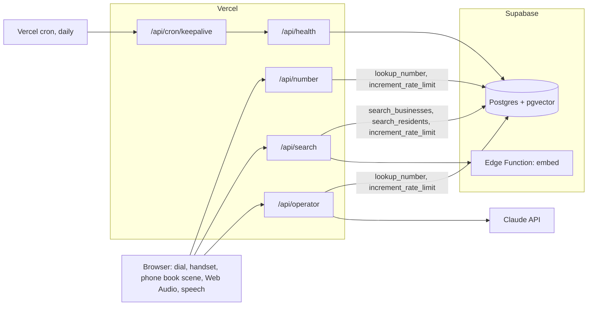

# Dial Tone from the Grave

Kiroween 2026 entry, Resurrection category. In 1998 the line went dead. Tonight, someone picked up.

You pick up a haunted rotary phone, dial 1023, and a ghost operator asks what you need. Say "someone to fix my geyser tonight in Edenvale" and the results land on a cursed phone book page called The Dead Pages. The old book could only find what you already knew the name of. This one searches by meaning. Other numbers reach other ghosts, and a wrong number gets static and a whisper.


Live: https://dial-tone-from-the-grave.vercel.app

All businesses, people and numbers in The Dead Pages are fictional.

## Run it locally

You need Node, pnpm, a Supabase project and an Anthropic API key.

```bash
git clone https://github.com/elivation/dial-tone-from-the-grave.git
cd dial-tone-from-the-grave
pnpm install
cp .env.example .env.local
# fill in the values, see the table below
pnpm dev
```

Open http://localhost:3000. A fresh Supabase project also needs the schema, the embed function and the demo listings: see "Database and Edge Function scripts".

## Environment variables

Everything lives in `.env.local`, which is gitignored. Variables marked secret are server only and must never reach the browser. Anything starting with `NEXT_PUBLIC_` is bundled into client code on purpose.

| Variable                               | Secret | Default            | What it does                                                                              |
| -------------------------------------- | ------ | ------------------ | ----------------------------------------------------------------------------------------- |
| `NEXT_PUBLIC_SUPABASE_URL`             | no     | none               | Supabase project URL (Settings, API).                                                     |
| `NEXT_PUBLIC_SUPABASE_PUBLISHABLE_KEY` | no     | none               | Publishable key (`sb_publishable_...`). Safe in browser code.                             |
| `SUPABASE_SECRET_KEY`                  | yes    | none               | Secret key (`sb_secret_...`). Used by route handlers, the seed script and the embed call. |
| `ANTHROPIC_API_KEY`                    | yes    | none               | Claude API key. Only `/api/operator` uses it.                                             |
| `ANTHROPIC_MODEL`                      | no     | `claude-haiku-5-5` | Model for the ghost operators.                                                            |
| `OPERATOR_LIMIT_PER_IP_PER_HOUR`       | no     | 20                 | Claude calls per IP per hour.                                                             |
| `SEARCH_LIMIT_PER_IP_PER_HOUR`         | no     | 60                 | Search and number lookups per IP per hour.                                                |
| `CLAUDE_DAILY_GLOBAL_CAP`              | no     | 500                | Claude calls across all visitors per day. The hard stop on spend.                         |
| `MAX_TURNS_PER_CALL`                   | no     | 6                  | User turns before the operator hangs up.                                                  |
| `MAX_TURNS_PER_LISTING_CALL`           | no     | 4                  | User turns before a listing from the book hangs up.                                       |
| `MAX_INPUT_CHARS`                      | no     | 300                | Longest message accepted.                                                                 |
| `CRON_SECRET`                          | yes    | none               | Protects `/api/cron/keepalive`. Set it in the Vercel dashboard and nowhere else.          |
| `NEXT_PUBLIC_RING_IN_ENABLED`          | no     | `true`             | Set to `false` to stop the phone ringing by itself (tests and demos).                     |
| `NEXT_PUBLIC_RING_IN_MIN_S`            | no     | 45                 | Shortest wait before it rings by itself, in seconds.                                      |
| `NEXT_PUBLIC_RING_IN_MAX_S`            | no     | 120                | Longest wait, in seconds.                                                                 |
| `NEXT_PUBLIC_RING_IN_MAX_PER_SESSION`  | no     | 2                  | Most self-rings in one tab.                                                               |

Two more variables are read by the database scripts only. They are not in `.env.example`, they are secret, and the app itself never reads them: `SUPABASE_DB_URL` (the Postgres connection string, for `db:*` scripts) and `SUPABASE_ACCESS_TOKEN` (for `fn:deploy`).

## Architecture



The browser never talks to Claude or to the database directly. Every Claude call goes through `/api/operator`, which checks the per-IP limit and the daily cap first. Search embeds the query in the `embed` Edge Function (384 dimensions, the built-in gte-small model) and ranks listings with the pgvector RPCs. The cron job hits `/api/health` logic once a day so the free Supabase project does not pause.

Operator numbers and personalities live in `lib/operators.ts` only. Adding an operator needs no UI change.

## Database and Edge Function scripts

Every schema change is a migration file in `supabase/migrations/`. Nothing is changed by hand in the dashboard. Run the dry run first, read what it says, then push.

| Script                 | What it does                                                              |
| ---------------------- | ------------------------------------------------------------------------- |
| `pnpm db:push:dry`     | Shows which migrations would run. Always run this first.                  |
| `pnpm db:push`         | Applies the pending migrations.                                           |
| `pnpm db:verify`       | Runs `supabase/verify.sql` in a read-only session.                        |
| `pnpm db:types`        | Regenerates `lib/database.types.ts` from the live schema.                 |
| `pnpm db:seed`         | Loads the demo listings and spirit listings, with embeddings.             |
| `pnpm fn:deploy embed` | Deploys the embed Edge Function.                                          |
| `pnpm fn:smoke`        | Checks the embed function answers, and that it refuses a publishable key. |
| `pnpm db:search-smoke` | Runs a few real searches against the seeded data.                         |

## Tests

```bash
pnpm lint
pnpm typecheck
pnpm test        # Vitest, React Testing Library and fast-check
pnpm build
pnpm test:e2e    # Playwright against a local production build
```

`pnpm test:e2e` builds nothing for you, so run `pnpm build` first. To run the end-to-end suite against a deployed copy, set `PLAYWRIGHT_BASE_URL`:

```bash
PLAYWRIGHT_BASE_URL=https://dial-tone-from-the-grave.vercel.app pnpm test:e2e
```

The `@live` check makes one real 1023 call, so it spends one Claude request. It is skipped unless `PLAYWRIGHT_BASE_URL` is set.

## Built with Kiro

The specs, steering files and hooks that drove this project are in `.kiro/`. KIRO_USAGE.md explains how each Kiro feature was used, with examples.

## Credits

- Phone model: "WE500" by [Skyice](https://sketchfab.com/vicky12218), from [Sketchfab](https://sketchfab.com/3d-models/4425a0d9629c420788cf6b0d072f4564), licensed under [CC BY 4.0](https://creativecommons.org/licenses/by/4.0/). Changes: compressed and optimised for the web (meshopt, WebP textures), materials adjusted, and the goo, dust and candle effects added in code.
- Desk texture: Dark Wooden Planks from [Poly Haven](https://polyhaven.com/a/dark_wooden_planks), CC0. Converted to WebP.
- Fonts: Special Elite and Nixie One from Google Fonts, under the SIL Open Font Licence (OFL), self-hosted through `next/font`.
- Sound: all of it is generated at runtime with the Web Audio API. There are no recordings and no music.
- The poster stills in `public/poster/` are renders of our own scene.

## Licence

MIT, see LICENSE.
